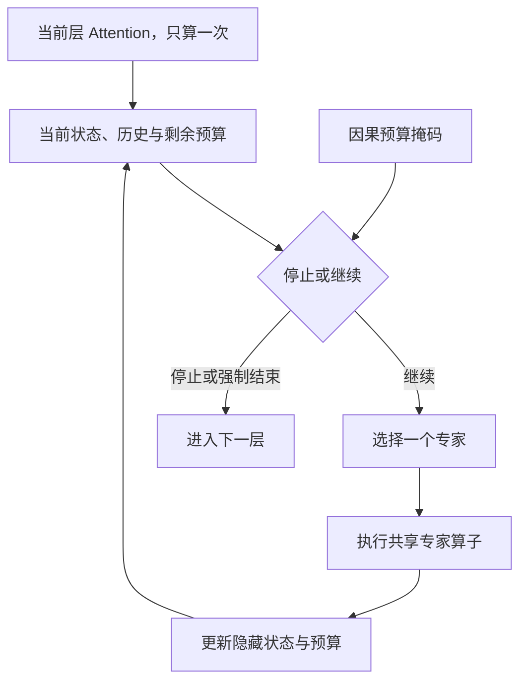

# Budget-aware Adaptive Expert-Loop MoE：Router 强化学习实验方案

**版本：1.0｜文献核查截至：2026-10-24｜目标硬件：8×NVIDIA RTX 6000 Ada**

**研究对象：**共享专家循环中的专家身份选择、闭环停止和计算预算控制。本文沿用前面对话的工作名称；它不是已发表方法的名称。

**完成状态：**已核查一手文献，完成架构设计、梯度推导、CPU 精确枚举/有限差分验证、参数与 FLOPs 计算。**尚未连接你们的 GPU 机器，也未进行 LLM 训练、吞吐或下游性能实测。**文中的超参数、阶段门槛和资源配额是实验建议，不是观测结果。

## 0. 研究决策

这个方向值得做，但应把问题写得比“用 RL 训练 Router”更窄：

> 在固定专家容量、可观测的因果状态和相同计算预算下，联合学习有序专家调用与停止，能否比固定专家链、仅学习停止、仅学习选专家，以及强非 RL 控制器更有效？收益能否在独立预训练种子和真实 GPU 延迟上成立？

推荐的首轮方案是：

1. **先在最后一个 FFN 上做干净的局部实验，再扩展到最后四层。**最后 FFN 没有后续 Attention，满足额外条件时可以真正按 Token 分解信用；多层控制则以完整序列路由轨迹作为 episode。
2. **每步只调用一个专家。**控制器先决定停止/继续，继续时选一个专家；暂不加入同轮动态 Top-k。循环数本身已经改变总专家调用数。
3. **沿用正常 MoE 的监督预热，然后冻结专家训练策略。**不直接在随机初始化的全模型上运行 GRPO。
4. **主算法先用 on-policy RLOO，独立轨迹数 G=2。**无偏估计器、可微停止、监督模仿和路径枚举之间形成可核验的对照。
5. **硬预算和期望预算分开报告。**第一版硬预算在每个 Token 内跨四层分配，不能宣称实现了跨 Token 的全局最优调度。
6. **126M 做筛选，280M 做确认；906M 只作条件扩展。**每张卡放完整专家池，先选择单卡并行实验或 DDP，不首先做专家并行。
7. **把训练额外开销和真实推理延迟列为主要结果。**只证明少调用专家，还不足以证明系统更高效。

这套方案允许得出有价值的否定结果：例如专家路径有收益而 RL 不占优，或者理论 FLOPs 改善但当前硬件延迟没有改善。它不预设 RL 必须胜出。

---

## 1. 文献核查与新颖性边界

### 1.1 最直接的先例

| 文献 | 核实范围 | 对本项目的约束 |
|---|---|---|
| MoEUT，NeurIPS 2024 [R02] | 共享层与 MoE；ACT 不在该文主要实验范围内 | Loop × MoE 已有较早先例 |
| Chain-of-Experts，2025 [R01] | 单层内顺序专家计算、逐轮重新路由、不同轮次独立 Router | 有序专家调用本身不是新颖点 |
| RMoE，ICLR 2025 [R08] | GRU 跨层传递路由历史 | “有状态 Router”也不能单独主张创新 |
| Mixture-of-Recursions，NeurIPS 2025 [R07] | Token-choice 起初预测递归深度；expert-choice 逐轮筛选 Token，并讨论因果与 KV 问题 | 闭环反馈应与预先承诺深度比较，且预算实现不能泄漏未来 |
| MoE-ERL，Findings EMNLP 2025 [R09] | 用原路径和扰动路径的表现差异优化内部专家路由 | 内部 Router 使用强化学习已有直接研究 |
| MoE-GRPO，CVPR 2026 [R10] | 将内部专家选择作为动作，使用 Gate-GRPO 等目标 | “专家选择是序贯 RL 决策”已有直接近邻 |
| ReMix，LLA@ICLR 2026 workshop [R11] | LoRA 专家路由，以监督损失为奖励，采用 RLOO | NLL reward + RLOO 是务实算法选择，不是本项目新算法 |
| LoopRPT，2026；核到 v2 [R12] | 学习循环退出分布；EMA 参考、逐步奖励、时间惩罚和 noisy latent rollouts | RL 停机和计算惩罚已被研究，必须作为核心近邻 |
| RLTT，ICML 2026 [R13] | 将学习信号分配到多个 latent loop 的预测 | 可借鉴过程监督；不能直接把其 surrogate 当本项目目标的无偏梯度 |
| Alloc-MoE，ACL 2026 [R18] | 通过敏感度分析、层级动态规划等分配激活预算 | 层与 Token 的预算分配不是空白 |

**新颖性判断：**在本轮核查中，没有确认一个与本文所有条件完全相同的成熟方案；但这不构成“世界上尚无人做过”的保证。共享专家、RL 选路、RL 停机、预算控制、历史记忆的各个组件都有先例。论文价值必须来自清晰的控制问题、严格的估计器/约束、可解释的机制证据，或可信的计算—质量优势。

### 1.2 强非 RL 对照与负结果

| 文献/方法 | 必须吸收的内容 |
|---|---|
| ACT [R15]、PonderNet [R14] | 停机不一定需要 REINFORCE。浅循环在固定轨迹上可直接对停止时刻求期望 |
| ReMoE，ICLR 2025 [R16] | ReLU 路由和自适应稀疏约束，提供连续优化的动态计算对照 |
| ProbMoE，ICML 2026 [R17] | 受基数约束的子集采样与可微 marginal surrogate，支持 Dynamic-k；不能把该 surrogate 叫作真实离散目标的精确梯度 |
| SparseMixer [R32]、Default MoE [R33] | 稀疏 Router 的任务梯度已有专门估计方法；应防止选过弱的标准梯度作为唯一对手 |
| Adaptive Depth in Looped Transformers，2026-07 [R19] | 学习退出与轨迹形成可能相互干扰；固定深度先验训练后，简单 confidence readout 常能竞争 |
| Sparse Layers are Critical…，2026-05 [R06] | 熵阈值早退出是重要简单基线；其计算指标不能直接当真实吞吐结果 |
| Mixture-of-Depths [R22] | 固定每层参与计算的 Token 容量，提供确定计算预算的另一种思路；自回归应用须处理因果性 |
| DirMoE [R23] | 将“选择哪些专家”和“专家贡献的幅度”分离，为本方案区分策略与算子提供相关背景 |

这里最改变实验次序的是 [R19]：应先确认轨迹本身有可利用信息，再比较怎样训练停止器。如果所有中间状态都很差，换一种 RL 算法通常解决不了问题。

### 1.3 前次调研的复核与修正

前文列出的 LoopMoE、SMELT、LOOM、Scaling Laws for Looped MoE、LatentLoop、MoRE 和 Training-Free Looped Transformers 的 arXiv 条目均已找到，不能将它们当作不存在的论文。[R03–R06, R40–R43]

需要收紧三处结论：

- LoopMoE 表中的 **0.8B 是计算等价的活跃参数计数**，共享权重重复调用会被重复计入；对应 physical active 参数为 0.6B。其 3B 实验中的 34.84→35.89 是论文报告，且该设置只有单个训练 seed。[R03]
- Sparse Layers 论文不支持“Looped-MoE 在任意条件下优于普通 MoE”；它明确区分相对 dense Base 的收益、相对普通 MoE 的 scaling，以及早退出的收益。[R06]
- LOOM 的深循环稳定技巧与 LoopMoE 的设计并不完全一致；不能把所有残差缩放、重注入和归一化组件直接叠加，便假设一定更好。[R03, R04]

另有 **Reinforced Adaptive Routing** 的官方摘要级线索，涉及 RL 选择激活专家数；其 OpenReview 元数据是 withdrawn submission，正文访问受限。本文不把它写成录用论文，也不根据未读正文声称它没有循环机制。发表前应补核全文。[R31]

### 1.4 相关但不等同的 RL 工作

ESRL、RSPO、Router Drift Control 主要讨论 MoE 的输出策略 RL、路由探索或 rollout/training 不一致。[R28–R30] 本项目把内部动作本身显式建模为随机策略，应单独推导概率。

尤其是 RDC 对确定性 Top-k 路由回放的偏差分析，不能被扩大解释成“随机 latent-action policy 记录并重放真实动作必然有偏”。相反，对冻结环境中记录的动作计算正确 joint logprob，是本方案实现梯度的正常步骤。

更早的 Conditional Computation 与 Routing Networks 已用 RL 学习条件计算和模块组合。[R20, R21] 因此项目应避免“首次用 RL 控制神经网络内部计算”这样的表述。

---

## 2. 可证伪的研究假设

| 编号 | 假设 | 关键对照 | 若不成立意味着什么 |
|---|---|---|---|
| H1 | 专家身份和调用顺序存在可学习的条件收益 | 固定/随机路径、固定调用数、路径交换 | 专家分工或轨迹训练可能不足，不能仅增加策略复杂度 |
| H2 | 看到中间结果再决定是否继续，优于起初一次预测深度 | 同预算的 open-loop depth predictor | 隐状态反馈可能没带来额外信息，简单深度预测足够 |
| H3 | 联合选路和停机优于分别优化其中一项 | route-only、halt-only、joint | 组合并不一定产生额外价值 |
| H4 | 预算条件化能形成有效的跨层分配 | 每层均匀配额、验证集选出的静态分配、规则/监督分配 | 动态预算的控制开销可能不值得 |
| H5 | RL 的收益超过强非 RL 估计器及模仿策略 | 可微停止、监督反事实价值、监督路径模仿 | 架构可能成立，但 RL 不是首选训练法 |
| H6 | 收益在真实 GPU 成本上仍成立 | 全模型 wall-clock、训练 GPU-hour、prefill/decode 分开 | 只能主张计算量收益，或需要改变调度粒度 |

优先级：**先 H1/H2，再 H3/H5，最后 H4/H6 的系统扩展。**不同时搜索大型模型、深循环、动态 Top-k、复杂记忆、异步 RL 五个维度。

---

## 3. 最小可行架构

### 3.1 主干与循环位置

使用 decoder-only Transformer：RoPE、Pre-RMSNorm、SwiGLU、输入/输出 embedding 共享、无主干 bias。每层一个专家池、池内 8 个专家，**各层专家不同，同层各轮共享专家**。

主实验 12 层：

- 第 1–8 层：标准 Attention + 单次 Top-1 MoE。
- 第 9–12 层：Attention 仍只计算一次，FFN 内部最多执行 4 次专家调用。
- 每层至少调用一个专家。STOP 只表示离开当前 FFN 循环，随后继续后面的 Transformer 层；它不等于停止生成，也不等于跳过整个后续模型。
- 只控制最后一层的版本用于局部信用分配实验。



### 3.2 把选择策略与连续幅度 gate 分开

正常 Switch 式预热保留一个连续 gate：

$$
q_{\psi,l}(e\mid u)=\operatorname{softmax}(W_{\psi,l}u)_e,
\qquad u=\operatorname{RMSNorm}(h).
$$

执行专家动作时：

$$
h^+=h+\gamma_l q_{\psi,l}(e\mid u)E_{\theta,l,e}(u).
\tag{1}
$$

**选择哪一个专家**由新的策略 \(\pi_\phi\) 控制；**该专家算子的连续幅度**由 \(q_\psi\) 决定。把 \((\theta,\psi)\) 一起视作计算环境参数 \(\Theta\)。Router-only 阶段冻结 \(\Theta\)，策略参数 \(\phi\) 只通过离散动作影响隐藏状态。

这个选择避免把预训练的 \(qE\) 突然换成 \(E\)，引发按 \(1/q\) 放大的残差尺度变化。严格策略梯度不要求无幅度 gate，只要求固定动作后环境前向不依赖 \(\phi\)。

代价是低 \(q\) 专家可能几乎不改变状态。因此必须记录被选 \(q\)、残差范数和不同专家动作的反事实差异；若这一点严重抑制探索，再做统一再适应的无幅度 gate 消融，不能悄悄改变所有算子的定义。

### 3.3 控制器的明确规格

后四层共用一个小控制器，记忆在同一 Token 的这些层之间传递；**不跨 Token 共享记忆**。

| 输入/模块 | 规格 |
|---|---|
| 当前状态投影 | RMSNorm 后的 \(d\) 维状态 → 128，含 bias |
| 上次专家 | 8 维 one-hot；新层初始为全零 |
| 当前 adaptive 层 | 4 维 one-hot |
| 8 个标量 | 当前轮次、剩余硬配额、请求预算、预算价格、相对更新范数、与上一步状态的余弦相似度、当前 log-RMS、剩余 adaptive 层数 |
| GRU | input=148，hidden=128，标准双 bias |
| actor | 128→9，含 bias：1 个 stop logit、8 个专家 residual logits |
| critic | 可选 128→1；主 RLOO 不必使用，推理删除 |

标量归一化规则在代码中固定；预算价格只来自外部设置或前一训练步的 dual variable。**禁止把真实下一 Token、当前真实损失、正确答案、未来 Token 隐状态输入 actor。**

GRU 状态只影响概率，不注入专家连续输出。重新计算 logprob 时，要沿记录的决策序列重新计算 GRU 并保留完整 BPTT，不能把旧缓存的 GRU hidden 当常数。

### 3.4 动作概率

使用分解的策略，而不是默认将 9 个 logits 当完全对称类别：

$$
\Pr(\mathrm{STOP}\mid o)=\sigma(z_{\rm stop}),
$$

$$
\Pr(e\mid o,\mathrm{CONTINUE})
 =\operatorname{softmax}\bigl(\log\pi_{\rm ref}(e\mid h)+\delta_\phi(o,e)\bigr).
\tag{2}
$$

这样增加专家数量不会自动改变初始停止先验。可取

$$
\pi_{\rm ref}(e\mid h)
=0.9\,\operatorname{softmax}(z_\psi(h)/T_{\rm ref})_e
+0.1\,q_\psi(e\mid h),
$$

取 \(T_{\rm ref}=0.25\) 为起点，并将 \(\delta_\phi\) 的最后一层初始化为 0；温度只在训练/校准集上调节。该平滑先验有完整支持，初始 greedy 专家路径复现原 Router；随机采样路径当然与 greedy 不同，必须实测其质量下降。使用 FP32 log-softmax/logaddexp 计算对数概率，避免先 softmax 再 log 造成下溢。平滑参考分布也使后述联合参数梯度不必额外处理参考 argmax 的跳变。

首个专家调用强制 CONTINUE，只计算专家选择 logprob。轮数或预算强制退出时概率为 1，不产生随机停止的 score。正常继续动作的 logprob 是
\(\log(1-p_{\rm stop})+\log p_e\)，正常停止为 \(\log p_{\rm stop}\)。

### 3.5 稳定性设置

主实验 adaptive 层固定 \(\gamma_l=0.5\)，非 adaptive 层为 1；都从预热开始使用。对 \(\gamma\in\{0.25,0.5,1\}\) 只做小规模验证集筛选，选定后全组一致。

不让 \(\gamma\) 依赖未知的最终停止次数 \(T(x)\)。也不首先叠加输入重注入、EMA hidden、逐轮独立 Router 等组件。只有确实观察到范数漂移或深度退化，才逐一加入并报告消融。[R03, R04]

---

## 4. 目标函数、预算和停止决策

### 4.1 从受约束优化开始

对训练序列 \(x_{1:n+1}\)，所有内部动作构成轨迹 \(\tau\)。令

$$
\ell_\Theta(x,\tau)
=-\frac1n\sum_{i=1}^{n}
\log p_\Theta(x_{i+1}\mid x_{\leq i},\tau),
$$

$$
C(\tau)=\frac1n\sum_{i=1}^{n}\sum_{l\in\mathcal A}T_{i,l},
\qquad \mathcal A=\{9,10,11,12\}.
$$

这里 \(C\) 的单位是“每 Token 在后四层的专家调用数”。主干其他固定调用、Attention、词表头和调度成本不用于这个简化控制目标，但必须纳入最终资源报告。

期望预算问题为

$$
\min_{\Theta,\phi}\mathbb E[\ell_\Theta]
\quad \text{s.t.}\quad \mathbb E[C]\leq \bar B.
\tag{3}
$$

拉格朗日形式：

$$
J(\Theta,\phi,\lambda)
=\mathbb E\!\left[\ell_\Theta+\lambda(C-\bar B)\right],
\qquad \lambda\geq0.
\tag{4}
$$

\(\lambda\) 的量纲是 nats/专家调用。固定 \(\lambda\) 时用下降更新模型和策略；对预算违反量用投影上升：

$$
\lambda\leftarrow
\left[\lambda+\eta_\lambda(\widehat{\mathbb E C}-\bar B)\right]_+.
\tag{5}
$$

神经网络参数化使该问题非凸；此更新**不保证找到全局最优，也不自动保证测试分布满足平均预算**。在不同预算与 OOD 数据上分别报告违反量。

### 4.2 两种预算协议

**HARD 协议：每 Token 路径配额。**

预先给定 \(B_i\in\{4,6,8,12,16\}\)。初始剩余配额 \(b_i=B_i\)；每次调用减 1。当前是第 \(j\in\{1,2,3,4\}\) 个 adaptive 层，未来还有 \(r=4-j\) 层。执行至少一次后，继续合法当且仅当

$$
t<4,\qquad b_i\geq r+1.
\tag{6}
$$

因此始终有

$$
\sum_{l\in\mathcal A}T_{i,l}\leq B_i,\qquad T_{i,l}\geq1.
$$

证明很直接：不变量是剩余配额至少覆盖未来每层一次调用；每次允许的额外调用保持该不变量，且每次调用都消耗一个整数单位。

主 HARD 实验令 \(\lambda=0\)，比较给定 cap 下的质量和实际消耗；不强迫模型花完配额。若希望同时节省平均消耗，可另做 \(\lambda>0\) 的实验，但不要混淆两个目标。

**SOFT 协议：平均调用预算。**

每 Token 硬上限仍为 16，期望目标取 \(\bar B\in\{6,8,12\}\)，以式 (5) 调节价格。控制器接收目标预算及当前价格。对不同目标可以维护独立的 \(\lambda_{\bar B}\)。

这允许不同 Token 实际执行不同次数，但**不提供每条请求总预算的精确保证**。第一版 HARD 也只是 Token 内跨层分配，某 Token 省下的额度不会直接送给另一个 Token。

### 4.3 为什么前文的一步收益停止条件不充分

前文建议“当下一轮预期损失下降大于成本才继续”。这是 myopic 规则，只在额外假设下才最优。

一个反例：现在停止损失为 1.0；先调用 A 后损失变成 1.1；再调用 B 后损失为 0.2；每次成本 0.1。

- 一步规则看到 \(1.0-1.1<0.1\)，会停止。
- 两步计划总成本 \(0.2+0.1+0.1=0.4<1.0\)，应该继续。

因此在局部、可观测历史或其充分信念状态 \(s\) 上，应比较完整 cost-to-go：

$$
V^*(s,b)=\min\left\{
L_{\rm stop}(s),\
\min_{e:c_e\leq b}
\left[\lambda c_e+\mathbb E V^*(s',b-c_e)\mid s,e\right]
\right\}.
\tag{7}
$$

多层时 STOP 只是进入下一层，所以 \(L_{\rm stop}\) 应替换为“离开当前循环后的后续价值”。真正的终端损失仍在模型输出处。

式 (7) 是决策结构，不表示推理时知道标签。训练可以用标签构造回报；部署策略必须仅基于可用前缀状态预测动作。若局部 \(h,m\) 不充分，问题是 POMDP；不能因用了 GRU 就宣称状态必然满足 Markov 性。

### 4.4 预算的单调性与边界

在专家算子、\(\gamma\) 和最大计算图固定、预算仅限制动作集合时，理想最优损失满足

$$
B_2\geq B_1\implies J^*(B_2)\leq J^*(B_1),
$$

因为较大预算允许复制较小预算的所有路径。这是可行域包含关系的结论。

它不保证一个训练出来的 budget-conditioned 网络自动单调。若增加预算反而显著变差，应测量单调性违反率，而不是把它掩盖为随机波动。若预算还改变残差尺度或算子本身，上述包含关系也可能失效。

---

## 5. 严格的策略梯度与信用分配

### 5.1 冻结环境时的精确目标

对固定数据及外部预算，轨迹概率为

$$
Q_\phi(\tau\mid x,B)
=\prod_{a\in\tau_{\rm stochastic}}
\pi_\phi(a\mid o_a).
\tag{8}
$$

令 \(F(\tau)=\ell_\Theta(x,\tau)+\lambda(C(\tau)-\bar B)\)。当 \(\Theta\) 冻结且式 (1) 不直接包含 \(\phi\)：

$$
\nabla_\phi \mathbb E[F]
=\mathbb E\left[
\sum_{a\in\tau_{\rm stochastic}}
(F-b_a)\nabla_\phi\log\pi_\phi(a\mid o_a)
\right].
\tag{9}
$$

这是对采样分布求导所得的 score-function 公式。[R24] 各 \(b_a\) 可以依赖输入和对应动作之前的信息，但不能与该当前随机动作产生未校正的依赖。若把单个公共 baseline 放到整个 score 总和外，它须独立于整条当前轨迹的随机动作；独立路径构造的 RLOO 满足此条件。

**不要再除以轨迹的随机长度。**目标已经定义为平均 NLL 和每 Token 成本；额外除以动作数会改变不同长度路径的相对权重。

### 5.2 主估计器：RLOO，G=2

对同一训练输入、同一冻结环境和同一预算，独立采样 \(G\geq2\) 条完整路径：

$$
b_{-g}=\frac{1}{G-1}\sum_{g'\ne g}F_{g'},
\qquad
\widehat g_\phi
=\frac1G\sum_g
(F_g-b_{-g})\nabla_\phi\log Q_\phi(\tau_g).
\tag{10}
$$

baseline 与第 \(g\) 条路径的随机数独立，因此其乘 score 的期望为零。这是采用 RLOO 的核心理由。[R11, R25]

对于 \(G=2\)：

$$
\widehat g_\phi
=\tfrac12(F_1-F_2)
\left(\nabla_\phi\log Q_\phi(\tau_1)
-\nabla_\phi\log Q_\phi(\tau_2)\right).
\tag{11}
$$

实际优化最小化

$$
\widehat{\mathcal L}_{\rm actor}
=\frac1G\sum_g
\operatorname{sg}(F_g-b_{-g})\,\log Q_\phi(\tau_g).
\tag{12}
$$

因为这里采用**正的损失 \(F\)**，不再加传统“最大化 reward”的负号。若代码用 \(R=-F\)，actor loss 则为 \(-\operatorname{sg}(R-b_R)\log Q\)。两套符号不能混用。

首版不做组内标准差归一化。把当前样本也计入组均值会将期望梯度缩小到 \((G-1)/G\)；组标准差则一般带来依赖样本的非线性再加权。它们可作为经验算法比较，但不能继续称式 (10) 的原始无偏估计。

### 5.3 Token 级与序列级奖励必须分开

**局部实验：**只控制最后一个 FFN，且 Token 配额独立、dropless、没有跨 Token Router memory 或竞争性 quota。此时没有后续 Attention，当前 Token 的动作只影响当前读出，可以按 Token 计算 NLL 和 RLOO。

**多层实验：**第 \(l\) 层位置 \(i\) 的动作会改变后续层位置 \(j\geq i\) 的表示。只配位置 \(i\) 的 CE 一般遗漏信用。因此：

- 一次完整序列的全部路由决策构成一个 episode。
- 同一序列的 \(G\) 条 rollout 必须是完整、条件独立的路径。
- 用整条序列的平均 NLL 与平均调用成本计算 \(F_g\)。
- 不把同一序列里的 Token 当作独立的 RLOO 样本。

这会增加方差。可以利用因果图只保留某动作的 descendant costs，但必须推导哪些损失和未来预算决策受影响；第一版不依赖这个复杂优化。

### 5.4 为什么不首先使用 PPO/GRPO

PPO 的 clipping 是 surrogate；GRPO 的组标准化也不是本项目目标的自动精确解。[R10, R34, R35] 它们不是不能用，而是会同时引入旧策略、概率比、状态分布和归一化的额外问题。

主线先使用同步 on-policy、每批只做一次 actor 更新、不维护独立 rollout 引擎。若策略梯度方差确实限制效果，再按以下顺序升级：

1. 增加 minibatch 的独立输入数量；
2. 对小范围验证 \(G=4\) 是否比 \(G=2\) 值得；
3. 用独立拟合的 baseline 或精确/抽样反事实控制变量；
4. 最后比较 PPO/GRPO，并逐项记录 router 的动作概率比。

若使用旧轨迹，冻结环境下完整路径 IS 比为

$$
w(\tau)=\prod_a
\frac{\pi_\phi(a\mid o_a)}
{\pi_{\phi_{\rm old}}(a\mid o_a)}.
$$

长轨迹连乘可导致高方差；逐动作 clipped ratio 并不等于精确的全路径校正。current/old 策略各自的 GRU 状态须沿相同动作史分别重算，不能复用 old memory。若还更新了专家环境，旧隐藏状态也不再对应当前转移，不能只换 Router logits 就称目标一致。

### 5.5 联合更新专家时，常规 CE 不是完整梯度

因为 \(\pi_\phi(a\mid h_\Theta)\) 的输入依赖专家：

$$
\nabla_\Theta J
=\mathbb E\left[
\partial_\Theta F_\Theta(\tau)
+F_\Theta(\tau)\,\partial_\Theta\log Q_{\Theta,\phi}(\tau)
\right].
\tag{13}
$$

只对选中路径做 CE backprop，保留第一项而忽略第二项，是实用的 **semi-gradient**，不应声称其对联合目标严格无偏。

小模型可启用完整 stochastic computation graph surrogate：

$$
\widehat{\mathcal L}
=\frac1G\sum_g
\left[
F_\Theta(\tau_g)
+\operatorname{sg}(F_\Theta(\tau_g)-b_{-g})
\log Q_{\Theta,\phi}(\tau_g)
\right].
\tag{14}
$$

固定采样动作求导时，必须允许 logprob 经 \(h_\Theta\) 反传。即使 \(\phi\) 冻结，也不能用 `no_grad()` 包住策略前向而切断它对输入的导数。

**严格 SCG 消融的可训练区域：**先冻结所有确定性 Top-1 前缀及输入/输出共享 embedding，仅更新 adaptive 区域的专家、幅度 gate、相关 norm 和允许训练的后续 Attention。共享 embedding 即使被称作“输出头”也会改变前缀输入，因此不能误解为只影响读出。若缓存到第九层 Attention 之后，该 Attention 及其前缀也保持冻结。这样所有可训练路由都由式 (8) 的平滑随机概率表示。若要更新整个确定性 Top-1 前缀，普通路径导数仅在其选择不变的区域适用；要获得同类完整随机图保证，应把那些选择也纳入随机动作和 joint logprob。

严格 SCG 核验关闭负载均衡、z-loss、entropy/KL 等辅助项，以 \(F=\ell+\lambda(C-\bar B)\) 为唯一目标。保留辅助项时必须重新定义完整目标、处理跨 Token/跨轨迹统计的依赖并推导梯度，不能沿用当前公式宣称优化同一 \(J\)。

实际次序：先以冻结环境结果作为主证据；再比较“交替 CE + Router RL”的 semi-gradient 与式 (14) 的完整版本。后者可能更高方差，不预设一定更优。

### 5.6 正则项与“无偏”表述

首个数学核验版本不加 entropy/KL 正则，采用完整支持的参考策略、较小学习率和预算 mask。

若之后把整条轨迹的 entropy/KL 加入 \(F\)，完整梯度还包括它的直接导数及其分布变化项。只在访问状态上加局部 entropy bonus 是常用 surrogate，但应这样标注。梯度裁剪、截断 GRU、丢弃极端 advantage 等也应明确记录，不能将实际训练过程整体描述成无偏优化。

---

## 6. 低方差替代路线

### 6.1 固定轨迹上的精确停机期望

若专家路径固定，且某个局部 Token 在各停止深度的读出损失均可计算，令 hazard 为 \(z_t\)，则

$$
q_t=z_t\prod_{s<t}(1-z_s)\ (t<T_{\max}),\qquad
q_{T_{\max}}=\prod_{s<T_{\max}}(1-z_s).
$$

可直接优化

$$
\mathcal L_{\rm halt}
=\sum_t q_t(\ell_t+\lambda t).
\tag{15}
$$

这避免采样停止时刻的 Monte Carlo 方差，是必须比较的 PonderNet 风格基线。[R14] 代价是训练时通常要计算全部深度。

精确性仅针对所固定的轨迹/局部目标。多层所有 Token 同时早退会改变后续 Attention，不能把每个位置的 \(\sum_t q_t\ell_t\) 直接称为完整模型所有联合路径的精确边缘化。

### 6.2 反事实价值与监督模仿

在训练数据上采样状态，比较 STOP、当前专家以及少量独立候选专家；每个候选执行后，**重新计算受影响的后续状态和动作**，得到代价标签。

可训练 \(Q_\omega(o,a)\) 预测代价，并采取 \(\arg\min_a Q_\omega\)，或者选择最好完整路径，监督其动作。标签在训练时可用，actor 输入仍只能使用当前可用状态。

此路线既是强对照，也是 RLOO 方差过高时的替代方案。它并不因使用监督 loss 作标签就“不够智能”；若它用相同总训练成本胜过 RL，应采用它并如实改变论文主张。

### 6.3 反事实 baseline 的正确条件

在实际当前动作 \(a\) 之前独立生成替代候选与后续 rollout，构造 \(\widehat b(o)\)。只要它条件于动作前信息与 \(a\) 独立：

$$
\mathbb E[\widehat b(o)\nabla\log\pi(a\mid o)]=0.
$$

不能直接用“所有其他专家的平均值，排除已选专家”作为无偏 baseline，因为这个集合依赖已选动作。固定候选集或独立抽样候选是安全的；COMA 提供反事实信用分配的背景，但不能忽略这里的顺序依赖。[R27]

### 6.4 奖励塑形不应改变原问题

若额外使用势函数，应在有限 episode 中令终端势为 0，并采用

$$
r'_t=r_t+\Phi(s_{t+1})-\Phi(s_t).
$$

于是总回报变化为 \(-\Phi(s_0)\)，只差一个与动作无关的常数。任意加入“隐藏状态变化大”“专家更不同”“entropy 更低”的奖励，没有这种保证。[R26]

这个保证用于固定环境下的策略学习。若联合更新时 \(s_0=h_\Theta\) 或势函数本身依赖可训练参数，该起点项可能依赖 \(\Theta\)，直接反传会改变联合目标。联合模式应仍以原 \(F\) 计算 pathwise 梯度；势函数只作 detach 的 score 控制变量，或显式补回起点项。

主实验不把专家多样性作为目标。重复使用同一专家可能是正确的迭代算法；应测它是否有用，而不是预先禁止。

---

## 7. 已完成的数学验证

使用 NumPy/FP64 构造了一个 3 专家、最多 3 次调用、至少 1 次调用的有限树，所有终端路径数为

$$
3+3^2+3^3=39.
$$

状态转移是固定的二维残差非线性算子；策略为带 mask 的 softmax，损失为终端误差加调用成本。没有训练真实语言模型。

| 检查 | 实际结果 |
|---|---:|
| 全路径概率之和 | 0.9999999999999999 |
| 精确期望损失 | 0.19722830591662754 |
| score-function 梯度 vs 中心有限差分，最大绝对误差 | \(6.06\times10^{-12}\) |
| 精确枚举的 G=2 RLOO 期望 vs 真梯度 | \(2.95\times10^{-17}\) |
| 自包含组均值估计 vs 真梯度的一半 | \(1.65\times10^{-17}\) |
| 平均 score 的最大绝对值 | \(2.60\times10^{-17}\) |
| 精确 halt expectation 梯度 vs 有限差分 | \(3.49\times10^{-12}\) |

另验证了前述 myopic 反例及终端势为零时的 telescoping identity。附录 B 包含完整验证代码，可单独保存运行。

还需区分本方案的两个 likelihood：

$$
\mathbb E_\tau[-\log p(y\mid\tau)]
\ \geq\
-\log\mathbb E_\tau[p(y\mid\tau)].
$$

例如两条路径各以 0.5 概率出现、正确标签概率为 0.9 和 0.1，二者分别为 **1.203973** 和 **0.693147**。本方案优化的是一次执行路径的期望 NLL，不能把它描述成对所有路径边缘化后的 NLL。

这些检查证明的是有限测试问题上的公式和实现一致性；它们不证明深模型收敛、RL 优于监督法，或 8 卡能够达到某一吞吐。

---

## 8. 数据、任务与实验阶段

### 8.1 两条任务线

**A. 可控机制任务。**使用自己生成、可程序验证的任务，便于构造独立的难度、组合与长度划分：

| 任务 | 训练分布 | 主要测试 | 注意事项 |
|---|---|---|---|
| 模 97 的仿射函数组合 | \(f_{a,b}(z)=(az+b)\bmod97\)，短程序和随机初值 | 未见过的函数组合、较长组合、相同长度不同组合结构 | 所有 0–96 用单独符号 Token，答案可为单 Token |
| 括号表达式求值 | 限定操作集、深度与值域，精确生成器评分 | 新的语法树、深度增加、交换顺序干预 | 按规范化语法树划分，防止模板泄漏 |
| 有长依赖进位的整数加法 | 长度和进位链分层 | 相同长度不同进位难度、长度 OOD | 难度标签只用于分析，不输入 Router |
| 受控非交换算子环境 | 固定的矩阵/有限域算子，已知转移 | 动作顺序、STOP 与最短预算策略 | 用于验证控制算法，不等同于学习语言专家的成果 |

先以仿射组合为主任务、表达式求值为验证任务。固定生成规则、随机种子和 train/validation/test 的程序族划分；不能只随机切分几乎相同的程序实例。

**FFN-only 的能力边界：**额外专家调用不会增加新的跨 Token Attention 传播轮次。因此，不把“更多 FFN loop”直接解释为“更多图搜索 hop”。若核心收益只在需要反复跨 Token 取信息的任务上缺失，应另做完整 block 循环扩展，不据此否定所有 Loop × MoE。

**B. 通用语言建模。**使用官方 FineWeb-Edu 的 `sample-10BT` 作为可取得的大数据源，固定 revision、文档列表和处理脚本。[R38] 该名称的 10B 以 GPT-2 tokenizer 计数；本方案自己的 Token 数必须重新计算。

建议：

- 在训练文档的固定 200MB 文本上训练 byte-level BPE，词表 **32768，包括特殊 Token**；所有模型共用 tokenizer。
- 先按文档身份/去重指纹划分，再训练 tokenizer 和构造 block；validation/test 文档完全不参与 tokenizer 拟合。
- 固定 5M Token validation、5M Token test；训练从其余文档取确定性的前 \(D\) 个有效 Token。
- 训练序列长 1024；packing 时保留文档边界并采用相应 attention mask，所有比较使用相同规则。
- 报告 nats/token、perplexity、每文档损失，以及短/长文本分层；不要跨不同 tokenizer 直接比较 perplexity。

下游选择 PIQA、HellaSwag、ARC-Easy 和 BLiMP 等相对适合小模型的任务，通过固定版本的 lm-evaluation-harness 或等价评分适配器评测。[R39] GSM8K/MATH 可以作为探索性测试，但 126M–280M 模型的低基线和高方差使它们不适合做唯一证据。

### 8.2 P0：机制与估计器

**P0a 已完成：**第 7 节的精确树与梯度验证。

**P0b 待执行：**

- 主干约 1.90M 参数：\(L=4,d=128,m=256,E=4,V=512\)，同样 MHA/SwiGLU/tied embedding；上述数字仅为主干，actor 参数按实现另记。
- 只循环最后 FFN；主任务只在已知 query delimiter 后的最后位置预测一个答案符号。
- 这个版本 \(\mathcal A=\{L\}\)、预算为 1/2/3、最大深度为 3；actor 的专家头为 4 类。其余层固定单次调用，不能沿用四层版本的 \(B\geq4\) 配额代码。
- 最大 3 次专家调用，所有终端专家路径数 \(4+16+64=84\)。
- 用约 20M 合成训练 Token 形成轨迹；先冻结环境，比较 exact expected objective、RLOO G=2/4、精确 halt expectation、监督路径模仿和固定路径。
- 精确期望训练基线在一个独立的小型训练子集上穷举 84 条路径，并把全部计算记账；另在不参与训练的少量验证状态上穷举作为 oracle 诊断。验证 oracle 不回流训练，带真实标签的 oracle 不作为可部署方法。

**进入下一阶段的条件：**有限树梯度检查通过；hard mask 零违反；RL 能在这个小问题上降低其定义的目标，且能够处理“先恶化后改善”的互补路径；学习得到的策略在未见程序上仍有收益。

如果 exact objective 能学而 RLOO 不能，优先改估计器/探索；如果连 oracle 都找不到有用路径，优先改轨迹训练与任务，不去扩大模型。

### 8.3 P1：126M 筛选

配置见第 11 节。建议先执行一个 250M-Token 检查点，若训练稳定且有路径效用，再到 1B Token。

同一预训练 seed 的控制器实验都从同一专家检查点开始：

1. 仅最后 FFN 控制：验证 Token-local 的方法效果；此时 \(\mathcal A=\{L\}\)，预算 1/2/3/4，其余层固定一次。
2. 后四层控制：切换到完整序列 RLOO。
3. 第一轮 Router 训练可用序列长 256 排查方差和实现，正式对照恢复 1024，并报告两者区别。
4. 每个 actor arm 首先使用 50M 独立输入 Token 的训练流；G=2 意味着另有约 100M 路径前向 Token，不能仍只记为 50M 计算。
5. 测 HARD \(B=4,6,8,12,16\) 和 SOFT \(\bar B=6,8,12\)。先以 \(B=8\) 做主要筛选，再构建完整曲线。

筛选只选少量配置；不能根据 test set 连续更换算法和阈值。主结果至少使用 3 个独立的预训练 seed，而不仅是同一主干上的 3 个 actor seed。

### 8.4 P2：280M 确认

- 3 个独立主干 seed，每个 2B Token 的公共预热。
- 对 P1 最强的非 RL 对照、joint 无历史、joint 有历史做主要确认；route-only/halt-only 的关键消融至少保留。
- 每个确认 arm 先给 100M 输入 Token 的 actor 训练上限；以验证集曲线决定早停。
- 在冻结主干结果稳定后，选最强 2–3 个方法比较交替 semi-gradient 更新；小规模额外比较完整 SCG joint update。
- 训练预算允许时，独立训练普通 parallel MoE 和固定 CoE，比较架构层面的成本—质量；这与冻结检查点上的控制器实验分开。

不直接跳到 906M。只有 P2 的收益跨 seed、跨数据且在总成本核算后仍存在，才考虑扩大规模或循环范围。

### 8.5 阶段门槛与转向

以下阈值是**预注册建议**，应在看测试集前固定，不是已经观察到的结果：

| 门槛 | 建议通过标准 | 未通过时的下一步 |
|---|---|---|
| 实现正确性 | FP64 小树梯度误差 < \(10^{-7}\)；预算/因果测试零结构性违反 | 修公式或调度，停止扩大训练 |
| 轨迹效用 | 验证集有可重复的专家/深度条件收益，且可训练策略能捕获一部分 | 扩大浅层搜索、改预热；不立即增加 RL epochs |
| 相同推理成本下质量 | 至少 0.01 nats/token 改善，或明确的任务准确率收益；独立 seed 方向一致 | 比较更强非 RL 控制器，检查是否只是校准差异 |
| 相同质量下计算 | 全模型 FLOPs 至少约 10% 的改善作为有意义目标 | 扩大 adaptive 层范围前先检查质量/训练稳定 |
| 系统收益 | 给定明确 serving 设置，全模型吞吐/延迟至少约 5% 改善且不牺牲尾延迟 | 优化 dispatch，或限制为计算量结论 |

0.01 nats 相当于 perplexity 约 1% 的相对变化。任何阈值都不能替代置信区间、代价核算和实际效果解释。

---

## 9. 预热、Router 训练与联合更新

### 9.1 公共预热

前 \(L-4\) 层固定 1 次专家调用；前 90% 预热中，后四层每个 batch 独立采样层级深度 \(T_l\sim U\{1,2,3,4\}\)，同一层在该 batch 内使用同一深度。最后 10% 使用外生的 Token-wise 随机深度，并独立抽取预算、按 reserve mask 截断；这些抽样不读取标签或未来状态。这样既覆盖不同深度，也让后续 Attention 见到不同 Token 位于不同深度的混合状态。所有控制器 arms 共用这一预热。深度由外部随机先验决定，gate 不决定自己被监督多少次。

各轮使用同层 \(q_\psi\) greedy Top-1；反向保留幅度 gate 的梯度。若专家塌缩，先用常规负载均衡和更强稀疏路由梯度对照处理，不立即强制相邻轮选择不同专家。[R32, R33, R44]

| 超参数 | 初始值/范围 | 说明 |
|---|---|---|
| 精度 | BF16 autocast；Router/损失统计 FP32 | 不首先引入 FP8 |
| 优化器 | AdamW，\(\beta=(0.9,0.95)\)，eps \(10^{-8}\) | 数值为建议起点 |
| 主干 peak LR | 126M: \(3\times10^{-4}\)；280M: \(2\times10^{-4}\) | 小筛选比较 0.5×/1×/2× |
| weight decay | 0.1；norm/bias 不衰减 | 所有 arms 一致 |
| warmup | 总 updates 的 2%，随后 cosine 到 peak 的 10% | 依据实际完整 update 数配置 |
| 梯度裁剪 | global norm 1.0 | 记录触发率 |
| dropout | 0 | 冻结环境也用 eval 模式 |
| RMSNorm eps | \(10^{-5}\) | 跨方法一致 |
| RoPE base | 10000 | 不把长上下文外推混入首轮 |
| aux balance / z-loss | \(10^{-2}\) / \(10^{-3}\) 为起点 | 用于预热/常规 semi-gradient 环境更新；严格 SCG 核验关闭 |
| adaptive 残差尺度 | 0.5 | 固定，先不引入输入重注入 |

负载均衡统计可以作为训练损失使用，但不能在当前前向中根据整条序列的未来位置排序改变哪些 Token 获准执行。

### 9.2 Router-only 的默认设置

| 项目 | 默认 |
|---|---|
| 环境 | \(\Theta\) 冻结、dropout=0；无专家 optimizer state |
| 算法 | RLOO，G=2；每批轨迹一次更新 |
| actor optimizer | AdamW，LR \(10^{-4}\)，weight decay 0 |
| LR 小筛选 | \(3\times10^{-5},10^{-4},3\times10^{-4}\) |
| 初始 stop hazard | 0.5；首调用/强制退出由 mask 处理 |
| 温度/参考 | \(T_{\rm ref}=0.25\) 起点，参考分布权重 0.9/0.1 |
| entropy / KL | 数学基准默认 0；有需要再单独加入标明的 surrogate |
| advantage | 原始 LOO 差；不做当前组标准差归一化 |
| 梯度裁剪 | 1.0；记录裁剪率和未裁剪梯度范数 |
| SOFT 价格 | \(\lambda_0=0.01\)，\(\eta_\lambda=10^{-3}\) 为校准起点；每个预算独立维护 |
| 停止/专家探索 | 无强制“不重复专家”规则；候选默认全部 8 个 |
| 验证频率 | 每约 5M 新输入 Token；保存最好验证集 Pareto 检查点 |

若预算振荡，先减 \(\eta_\lambda\)、用前一轮 EMA 成本更新，而不是改动测试时预算定义。若增加 clipping、hard candidate pool 或探索温度退火，应明确记录它们对目标与支持集的影响。

\(T_{\rm ref}\) 仅用于选择策略的平滑 prior，不能改变冻结环境的幅度 \(q_\psi\)。若 warmup 轨迹到动态深度仍出现明显分布偏移，首先检查公共的 Token-wise 深度覆盖是否足够。

### 9.3 Router-only 伪代码

以下是实现协议，不是声称本次已完成的训练仓库：

```python
# One sequence is one episode in the multi-layer setting.
# In terminal-FFN experiments only, independent token episodes are allowed.
freeze(backbone_and_amplitude_gates)
actor.train()

for batch, requested_budget in input_stream:
    # G independent complete routes for each identical input and budget.
    routes = []
    for g in range(G):
        routes.append(rollout_frozen_environment(
            batch, actor, requested_budget,
            independent_rng_stream=g,
            record_actions=True,
            record_actor_observations=True,
            causal_masks=True,
        ))

    # Each F[g, sequence] uses all affected supervised positions.
    F = stack([r.mean_nll + dual_price * r.calls_per_token for r in routes])
    loo = (F.sum(dim=0, keepdim=True) - F) / (G - 1)
    advantage_cost = (F - loo).detach()

    # Recompute actor probabilities from stored environment observations.
    # Recompute the GRU history with gradients; do not reuse detached old m.
    log_joint = stack([
        actor.replay_logprob(r.actions, r.observations, r.legal_masks)
        .sum_over_stochastic_decisions()
        for r in routes
    ])
    actor_loss = (advantage_cost * log_joint).mean()
    optimizer.zero_grad()
    actor_loss.backward()
    clip_grad_norm_(actor.parameters(), 1.0)
    optimizer.step()   # No additional epochs over these on-policy routes.

    if protocol == "SOFT":
        measured_cost = distributed_mean(stack([r.calls_per_token for r in routes]))
        dual_price = max(0.0, dual_price + dual_lr * (measured_cost - target_budget))
```

GRU cache、router 参考分布、动作 mask 和采样概率必须对应同一轨迹。分布式训练按输入序列分组，不能把不同输入的 reward 混成一个 RLOO group。

### 9.4 后续联合更新

主线可先用 4 个 actor-only updates : 1 个小 LR 环境 CE update，环境 LR 取预热末期的约 0.1×。每次环境变化后重新采样，不继续使用旧隐藏轨迹。

这是 semi-gradient 路线，单独命名和报告；另在小模型上按第 5.5 节限定可训练区域，启用式 (14) 的完整 SCG 梯度。比较梯度估计器时，两组使用相同可训练参数集合。若联合训练破坏固定轨迹阶段的优势，保留冻结主干的结果，同时比较“固定深度覆盖训练 → 再拟合策略”的两阶段版本，回应 [R19] 指出的轨迹形成问题。

---

## 10. 必须执行的对照与消融

### 10.1 同一冻结主干上的控制器比较

| ID | 方案 | 选专家 | 停止 | 预算 | 回答的问题 |
|---|---|---|---|---|---|
| C0 | 固定 T=1/2/4，以及验证集选出的静态跨层分配 | 原 \(q_\psi\) greedy | 固定 | 静态 | 给出简单、便宜的成本曲线 |
| C1 | 随机/固定专家路径 | 随机或固定 | 独立静态或随机深度 | validation 校准到相同平均成本 | 路径选择本身是否重要 |
| C2 | 轻量 confidence/收益预测退出 | 原 \(q_\psi\) | 监督标量头或阈值 | 校准 | 强简单退出基线 |
| C3 | PonderNet/LoopRPT 风格 halt-only | 原 \(q_\psi\) | 学习退出 | 相同 cap/平均成本 | RL 是否只是学会了停止 |
| C4 | route-only RL | RLOO | 固定 T=2 | 固定 | 选路单独的作用 |
| C5 | joint RL，无历史 | RLOO，MLP | RLOO | 有预算输入 | 顺序状态反馈是否足够 |
| C6 | joint RL，有历史 | RLOO，GRU | RLOO | 同上 | 额外记忆的增益 |
| C7 | 监督反事实 Q / 路径模仿 | 监督 | 监督 | 同上 | 高方差 RL 是否必要 |
| C8 | 初始一次预测各层深度 | 与 C5/C6 同专家策略 | open-loop | 同 cap | 每轮反馈是否胜过预承诺 |

P1 先跑 C0、C2、C3、C4、C5、C6；P0 必须包含 C7 和精确期望基准；C7/C8 在 P1 保留最强配置。不是对所有超参数做笛卡尔积。

C3 的两个层次要区分：最后 FFN 上式 (15) 可以精确；移到多层后的 LoopRPT 风格方法是移植/适配，不能冒称官方模型复现或完整联合路径的精确边缘化。

C2 至少包含一个不做 full-vocabulary probe 的轻量标量预测头。完整词表 entropy baseline 另测，**把每次 probe head 的成本计入**，不能因为漏算读出而成为虚假的强基线。

C5 的 MLP 做参数量接近 GRU 的版本，同时报告原始参数；新增控制器只有约 0.07% 的主模型参数，但仍不能假装其容量和计算为零。

C1 若逐样本借用联合策略的实际深度，需要一次额外 rollout；这类“完全同调用数”的比较只作机制干预，或计入取得深度的全部开销，不能免费放入可部署 Pareto。C8 的初始深度分配器须重新训练、匹配容量和训练预算；不能仅把已训练闭环网络删掉反馈当作唯一对照。

### 10.2 两种公平性协议

**协议 A：隔离控制器。**所有方法使用同一冻结专家环境、同一数据划分、同一预算和公共预热。各自额外训练成本完整报告；无需为便宜的阈值法虚构训练开销。结论限定于“如何控制这组已训练算子”。

**协议 B：比较整体研究配方。**在相同总训练 FLOPs 或 GPU-hour 下，允许固定 MoE/固定 CoE 把省下的 Router 学习成本用于继续 CE 训练。最终同时比较质量、推理成本和总训练投入。

再做独立架构对照：

- 普通 parallel MoE：例如同轮 Top-2，与两次顺序 Top-1 在专家调用矩阵 FLOPs 上接近。
- 固定深度 CoE：参数池相同，独立训练与适当调参。
- 动态稀疏非 RL 架构：优先选择 ReMoE 或 ProbMoE 中一个可可靠实现的强方法。[R16, R17]

不同架构必须分别在合理配置上训练，不能只在一个 loop checkpoint 上临时改 forward 后，用差结果宣称循环优势。近似匹配时逐项报告总参数、实际调用数、FLOPs、训练 Token、输出头成本和 controller 成本；接受小差异，但不能隐瞒。

### 10.3 机制干预

1. **固定整条轨迹的专家调用数与专家多重集，交换顺序。**每次从相同输入重新执行全部路径，不复用原路径的后续 hidden。只对同一层专家池中的身份交换；跨层专家通常不能随意互换。
2. **局部动作替换并重新路由。**用于研究实际策略的闭环纠错；与“完全固定路径”的干预分开。
3. **同一状态固定多算一轮/强制提前退出。**测长远收益，不只测临时 probe 的 NLL。
4. **移除/打乱路由历史。**比较保持参数量的无历史控制器；测试时随机打乱只是干预，不能代替重新训练消融。
5. **移除预算输入、静态分配、预算 OOD。**训练预算可取 4/8/12/16，额外测 5/7/10/14；hard mask 始终正确。
6. **冻结专家与联合更新比较。**判断收益来自控制器，还是来自额外的专家再训练。

路径交换可能造成分布外状态。因此其性能下降仅说明顺序敏感，不能单独证明专家已成为“可解释程序”。还需要未见组合、可迁移干预和任务结构的证据。

### 10.4 数学上的顺序效应

固定两个光滑专家算子 \(A,B\)，忽略路由边界变化，令 \(F_A(h)=h+\eta A(h)\)，则

$$
F_B(F_A(h))-F_A(F_B(h))
=\eta^2\bigl(J_BA-J_AB\bigr)(h)+O(\eta^3).
$$

这里 \(O(\eta^3)\) 需要足够的二阶光滑性和局部有界性；仅一次可微通常只能写 \(o(\eta^2)\)。对本方案，应将幅度 gate 和归一化也纳入 \(A,B\) 的定义。

这个展开说明组合一般不交换，但不是模型能力或泛化提升的定理。普通多层网络同样能复合函数；研究要验证的是在给定预算和参数共享条件下，学到的顺序是否有价值。

---

## 11. 8×RTX 6000 Ada 的资源核算

### 11.1 已核实硬件信息

官方资料给出每卡 48GB GDDR6 ECC、960GB/s 显存带宽、PCIe 4.0，以及 dense BF16/FP16 Tensor 峰值 364.2TFLOPS；结构稀疏 BF16 为 728.4TFLOPS。宣传的约 1457 对应 FP8 加结构稀疏，不能用于估计本文 BF16 训练。[R36]

PNY 官方资料明确 RTX 6000 Ada 不支持 NVLink。[R37] 8 卡显存合计 384GB 不等于一块透明的 384GB 显存。

以下默认 8 卡同机可见；若实际跨多台机器，先做各机独立实验/本地数据并行，按实测网络性能调整。没有假设你们的 PCIe 拓扑、P2P 支持或 CPU 内存已经达标。

### 11.2 精确参数配置

主干参数公式：

$$
P_{\rm backbone}
=Vd+4Ld^2+3LEdm+(2L+1)d+LdE.
\tag{16}
$$

分别对应 tied embedding、MHA 投影、SwiGLU 专家、RMSNorm、各层幅度 gate。控制器按第 3.3 节另计。

| 配置 | L | d | heads | m | E | 推理总参数 | 含可选 critic 的训练总参数 |
|---|---:|---:|---:|---:|---:|---:|---:|
| Pilot | 8 | 512 | 8 | 1024 | 8 | 126,044,169 | 126,044,298 |
| Main | 12 | 768 | 12 | 1024 | 8 | 280,269,065 | 280,269,194 |
| 条件扩展 | 16 | 1024 | 16 | 2048 | 8 | 906,373,641 | 906,373,770 |

所有模型 \(V=32768\)，head dimension=64，仅后四层 adaptive。主 RLOO 不必实例化 critic；若删除，训练参数也相应减少 129。

280M 的控制器推理参数为 206,345：

$$
98,432\ (\text{projection})
+106,752\ (\text{GRU})
+1,161\ (\text{actor}).
$$

实际代码仍须打印 `sum(p.numel())` 与分模块统计，核对是否额外加入了 position embedding、每轮 norm、bias 或未共享的头。

### 11.3 显存

按每参数约 16 bytes 的权重、梯度、master weight、Adam 状态预算：

| 配置 | 全参基础训练状态 | 环境 BF16 冻结、只训 controller 的基础状态 |
|---|---:|---:|
| 126M | 1.878 GiB | 约 0.237 GiB |
| 280M | 4.176 GiB | 约 0.525 GiB |
| 906M | 13.506 GiB | 约 1.691 GiB |

这**不是峰值显存**。还需 activation、轨迹记录、输出 logits、临时 cast、CUDA workspace、通信 bucket；某些优化器实现超过 16 bytes/param。数值说明参数与 optimizer state 不是 126M/280M 的主要障碍，不能反过来保证任意 batch 都能装下。

起始 microbatch 每卡 4 条×1024，先单卡压力测试；必要时减少 microbatch、增加梯度累积，再考虑 activation checkpoint。第一版不需要以 ZeRO-3 或 CPU offload 作为前提。

### 11.4 280M 的实际前向计算公式

按矩阵乘加为 2 FLOPs，序列长 \(S=1024\)，以完整 Attention 矩阵乘法计数：

$$
F_{\rm fixed}
=8Ld^2+4LSd+2Vd
=144.703488\ {\rm MFLOP/token}.
$$

单专家、幅度 gate、controller 的矩阵计算分别为：

$$
F_E=6dm=4.718592,\quad
F_q=2dE=0.012288,\quad
F_\pi=0.410880
$$

单位均为 MFLOPs。令后四层总专家调用数为 \(K\)，自愿 STOP 数为 \(H\)，决策数 \(D=K+H\)。强制退出无需另做决策：

$$
F(K,D)
=144.703488
+4.718592(8+K)
+0.012288(8+K)
+0.410880D.
\tag{17}
$$

若 gate 仅在继续动作被选后计算，式 (17) 不为 STOP 重复计算它。

| 后四层总调用 K | 平均每层调用 | 不含 gate/controller 的 MFLOPs | 可取的决策数上限 D | 加 gate/controller 的矩阵 MFLOPs |
|---:|---:|---:|---:|---:|
| 4 | 1 | 201.326592 | 8 | 204.761088 |
| 6 | 1.5 | 210.763776 | 10 | 215.044608 |
| 8 | 2 | 220.200960 | 12 | 225.328128 |
| 12 | 3 | 239.075328 | 16 | 245.895168 |
| 16 | 4 | 257.949696 | 16 | 264.818688 |

D 列是便于预算的上限，部分严格 cap 下会更紧；不是每条路径都达到。非线性、normalization、采样和调度未计入，因此最后一列不是整个程序工作量的严格上界。

**最关键的结论：**只在后四层循环时，从平均 4 次降到 2 次，主矩阵 FLOPs 约省 **14.63%**，不是 50%。相对于不需要新 controller 的固定四轮基线，再扣 controller 开销，理论节约更小。

上述 Attention 采用全矩阵口径；若只数 causal 下三角有用乘加，应换成 \(2L(S+1)d\)。最终报告使用一致口径，同时给出 profile；不能把其中任何一个当成 kernel 精确执行指令数。

全参数训练常用 \(F_{\rm train}\approx3F_{\rm fwd}\) 作初估，checkpoint 重算另计；冻结环境的 G 条轨迹大致是 G 次前向加小 actor 更新，不能直接按 G 次全参训练估算。

### 11.5 为什么 full-head probe 与 oracle 需要限量

280M 的一次完整词表投影：

$$
2Vd=50.331648\ {\rm MFLOPs},
\qquad
\frac{2Vd}{6dm}=\frac{V}{3m}=10.6667.
$$

也就是说，**一次词表读出的矩阵计算约等于 10.7 次单专家调用**。

最后 FFN 上枚举 STOP + 8 个专家、每个分支都计算精确 full-softmax NLL，至少要计

$$
8(6dm)+9(2Vd)
=490.733568\ {\rm MFLOPs/被查询状态},
$$

还没算 gate、后续层、norm 和 controller。它约为本方案 \(K=8,D=12\) 全模型**每 Token 平均前向成本**的 2.18 倍，不是整条长度 1024 序列前向的 2.18 倍。

因此：

- 全树枚举主要放在小词表 P0。
- 大模型候选评分只抽取少量状态，例如训练位置的 \(1/64\) 作为起点，并记录实际 overhead。
- 只算正确 Token 的 logit，无法得到精确 NLL 的 softmax 分母。
- 将候选合并为大 GEMM 能改善利用率，但不能从 FLOPs 账本里删除这些读出。

### 11.6 KV cache 与并行方式

FFN 内循环不会新增 Attention 轮次，仍使用标准的每层 KV cache。MHA、BF16、长度 1024 时，每条序列 cache 为 \(4LSd\) bytes：126M 约 16MiB，280M 约 36MiB，906M 约 64MiB。

把完整 block 循环作为后续扩展时，必须重新定义各轮 K/V 和动态退出后的可见状态；不能默认复用一个 cache 而不改变模型。[R07]

126M/280M 主方案每卡完整专家池，数据并行同步梯度。这样每次 loop 的专家 dispatch 留在本卡，避免跨 PCIe all-to-all。小模型多 seed 筛选可用 8 个单卡或 4 组×2卡；长训前用实测 scaling efficiency 决定是否 8 卡一起跑。

### 11.7 时间与训练配额

若全机实测吞吐为 \(Q\) 个**有效处理 Token/s**，计算工作量对应 \(D\) 个这样的 Token，则

$$
T_{\rm wall,h}=\frac{D}{3600Q},
\qquad
H_{\rm GPU}=\frac{8D}{3600Q}.
$$

2B Token 单次 CE 训练的纯敏感性表：

| 假设 Q | 墙钟小时 | 8 卡 GPU-hour |
|---:|---:|---:|
| 10,000 Token/s | 55.56 | 444.44 |
| 50,000 Token/s | 11.11 | 88.89 |
| 200,000 Token/s | 2.78 | 22.22 |

**这不是吞吐预测。**RL、反事实评分、验证和 CE 的 Q 不同，必须分别计时再求和；不能把普通预训练的 Q 直接套给整个研究。

建议按研究管理配额释放资源：机制/正确性阶段不超过约 64 GPU-hour，126M 筛选约 256 GPU-hour，280M 确认先预留约 1536 GPU-hour。它们是可调整的上限建议，不是完成项目必需的实测时间。

280M 的 3 个公共主干×2B Token 共 6B CE Token；若再独立训练两个架构对照、各 3 seed×2B，则增加 12B。Router、oracle 和验证另计。由此决定是否先完成控制器结论，再扩大架构比较，避免盲目铺满实验表。

microbatch=4、8 卡、sequence=1024、accumulation=8 时：

$$
4\times8\times1024\times8=262144\ \text{Token/update}.
$$

1B 需要 3815 个完整 updates，实际 1,000,079,360 Token；2B 需要 7630，实际 2,000,158,720。RL 的 G 不应被偷偷吞进“有效训练 Token”定义。

---

## 12. 工程实现与验证协议

### 12.1 先实现可读的真实稀疏路径

第一版使用 PyTorch SDPA、本地 expert index-select/scatter 和 BF16。E=8 足以用直接 dispatch 验证正确性。之后再换 grouped GEMM 或其他优化 kernel。

FlashAttention-2 的官方支持范围包含 Ada 和 BF16；不要将针对 Hopper 的 FlashAttention-3 路径当成默认 Ada 方案。[R45]

完整算出所有专家/所有轮次再 mask，可以作数值或可微对照，但不能作为稀疏加速结果。训练与推理都需记录真正执行了哪些矩阵乘。

DDP 动态稀疏会产生 unused parameters，先正确处理再优化；不能无条件设置 `static_graph=True`。梯度累积的 `no_sync()` 要包住相应 forward/backward。[R46]

activation checkpoint 应保存并重放同一离散路由及随机状态，推荐先采用非重入路径；否则反向重算可能跑了另一条轨迹。[R47] Router-only 阶段不为冻结专家创建 Adam 状态。

### 12.2 必须通过的正确性测试

| 测试 | 方法 | 防止什么错误 |
|---|---|---|
| Prefix invariance | 保持前缀不变、替换未来 suffix，比较此前 logits/路由 | 未来 Token 排序或隐状态泄漏 |
| Batch invariance | 更换同 batch 其他样本，比较当前样本的 greedy 结果 | 容量竞争、全 batch 动态筛选造成模型变化 |
| KV 一致性 | teacher-forced 前向 vs incremental decode | cache/loop 语义不一致 |
| 预算归纳检查 | 随机输入和所有预算，逐动作验证 reserve 与总调用数 | 少预留下一层、off-by-one |
| 轨迹 logprob | 小树显式乘概率 vs replay logprob | 漏掉 STOP/CONTINUE、重复计 forced STOP |
| RLOO 组完整性 | 检查各 g 输入/预算一致、随机流独立 | 错误 baseline 或伪多样本 |
| Checkpoint replay | 重算时专家身份、停止位置逐项一致 | 梯度对应另一条路径 |
| 梯度 golden test | 小树有限差分、精确期望、RLOO 期望对齐 | score 符号、长度归一化、遗漏路径概率 |

先在 FP32/FP64 确认结构一致性，再设 BF16 数值容差。随机路由的因果测试需固定按样本/位置/层/轮编号的随机流；仅设置一个全局 RNG seed 可能因 batch 形状变化而改变抽样顺序。

**dropless 是语义要求之一。**如果 overflow 时按整条 teacher-forced 序列的得分决定丢谁，即便 actor 自己只看前缀，dispatcher 仍可能引入未来依赖。负载 bias 若使用 EMA，应在 optimizer step 后更新，评估时固定。

### 12.3 Profiling

在你们的机器上执行并保存：

```bash
nvidia-smi
nvidia-smi topo -m
# 安装并构建官方 nccl-tests 后：
./build/all_reduce_perf -b 8 -e 128M -f 2 -g 8
```

命令用于观测，不修改系统拓扑设置。NCCL 测试来自官方工具。[R48] 同时记录 CPU/NUMA、驱动/CUDA、实际 PCIe 链路、P2P 结果、PyTorch 和 kernel commit。

每个配置至少 20 个 warmup steps、100 个计时 steps；计时前后同步 CUDA，主吞吐测试不打开昂贵 profiler。短窗口另分析 Attention、expert GEMM、compact/sort/scatter、actor、backward 和 all-reduce 时间。

分别报告：

- 训练：非 padding Token/s、optimizer-step 秒、全机/单卡、峰值 allocated/reserved。
- Prefill：输入长 128/1024/2048，固定 batch。
- Decode：batch 1/8/32，固定 prompt 和生成长度；报告完整 step 的 p50/p95。
- 动态执行：每轮存活率、每专家 Token 数、max/mean 负载、padding、controller 与 dispatch 时间占比。
- 数据并行：1/2/4/8 卡 scaling efficiency 与总 GPU-hour。

### 12.4 Late-loop 小 batch 与缓存的双重效应

忽略缓存且只看专家权重流量，专家处理 n 个 Token 的 BF16 算术强度约为 n FLOP/byte。GPU 的 dense BF16 峰值/显存带宽比约 379 FLOP/byte；每卡 4×1024 Token、8 专家均衡时第一轮约 512 Token/expert，若只剩 25% 存活则约 128。

这提示晚期循环可能受到带宽或 kernel launch 限制。但主模型单层 8 专家的 BF16 权重约 37.75MB，而官方给出的 L2 为约 96MiB；同层循环也可能受益于缓存复用。[R36]

所以这里是**需要 profile 的假设**，不能直接宣布晚期循环一定慢，也不能承诺缓存一定有效。若调度确实抵消节省，依次尝试活跃 Token compact、专家分组、少量深度 bucket；若还不够，再比较粗粒度停止策略。

粗粒度分组不得使用未来 teacher-forced Token 的分数决定当前 Token 路径。可以按已完成的独立样本分组，或使用因果生成阶段已可见的状态；不能为了加速破坏自回归定义。

### 12.5 冻结环境时共享确定性前缀

同一 teacher-forced 输入的 G 条路径，在第一次随机动作前计算相同。主模型前八层与第九层 Attention 可以只算一次，并缓存其输出：

$$
F_{\rm shared}
=8(7.864320+4.718592+0.012288)+7.864320
=108.625920\ {\rm MFLOPs/token}.
$$

对于 \(K=8,D=12,G=2\)：

$$
F_{\rm two\ routes}
=F_{\rm shared}+2(F-F_{\rm shared})
=342.030336\ {\rm MFLOPs/token},
$$

比两次完整前向的 450.656256 少约 **24.10%**。这是解析矩阵 FLOPs 结果，不是实测加速。

要求前缀环境冻结、前八层 greedy 固定、dropout=0、各分支后缀独立重算。cache 视为只读；若残差/scatter 原地写入，分支先 clone，避免互相污染。

环境更新后清缓存。若前缀也参与训练，不能直接使用 no-grad prefix 丢掉其导数；若该前缀明确冻结，缓存仍合法。free-running 生成发生 Token 分歧后，也不能继续共享整条 teacher-forced 缓存。实际训练账本按执行的算子计费，不把共享部分重复计算，也不删除分支后缀成本。

---

## 13. 评价、统计与结果表

### 13.1 主要结果

每个方法至少给出三组曲线：

1. **质量—推理矩阵 FLOPs：**NLL/准确率对实际调用量和全模型计算。
2. **质量—真实延迟/吞吐：**prefill、decode batch=1/8/32 分开。
3. **最终质量—总训练 GPU-hour：**包含公共预热、额外 rollout、oracle、teacher、critic、再训练与调参。

另外报告：

- 总唯一参数、一次路径实际触及的唯一专家参数、重复调用次数。
- STOP/专家选择 entropy、每层/每轮存活率、预算利用率与违反率。
- 专家负载、被选 gate 幅度、残差范数、state cosine、路径对任务难度的关系。
- 强制再计算一轮的真实后续损失变化，以及预测继续价值的校准。
- Greedy 路由结果和随机路由期望结果。训练随机策略不能只报告较好的多样本 best-of-G，再按单路径费用收费。

在验证集调整 stop bias/阈值以匹配预算；测试集固定。相同 cap 不意味着相同实际成本，主要 Pareto 比较应按实测均值校准，目标误差可设为 ±2%。若需随机混合两种策略来插值，混合选择必须在看到标签前独立抽样，并按真实执行成本计费。

### 13.2 随机种子和置信区间

- 确认阶段至少 3 个**独立预训练** seed，例如 11/23/37；同 seed 各方法共享初始化和训练数据次序，形成配对比较。
- actor seed 作为额外维度记录，不能用多个 actor seed 代替多个主干 seed。
- LM 置信区间按文档/独立数据块重采样，不把相邻数百万 Token 当独立样本。
- 算法任务每个主要测试划分建议至少 10,000 个独立程序实例，并分难度/长度报告。
- 以 paired differences 报告效应和区间；3 seed 的区间可能很宽，应同时列出每个 seed，不靠一项 p-value 给结论。
- 对延迟用多轮完整试验，保留系统抖动；不能只展示最快一次。

预先指定主指标：例如 \(B=8\) 附近全模型成本下的验证/测试 NLL、两个算法任务的 exact-match、batch=1 与 batch=8 decode latency。其他指标作为解释性结果，避免事后挑选赢家。

### 13.3 Oracle-gap 的正确解释

记录

$$
\Delta_{\rm sample}
=F_{\rm reference}
-\min_{\tau\in\mathcal S}F(\tau)
$$

可以诊断已搜索路径里有没有机会。但此 oracle 使用真实标签，不能部署；有限候选集也不一定找到真实最优。因此它既不是可训练策略保证能达到的收益，也不是所有更强方法不可超越的严格上界。

应同时报告：候选数、评分总成本、是否在训练/验证数据上选路径、策略最终恢复了多少收益，以及更大搜索是否仍显著改善。

### 13.4 建议的主结果模板

| 方法 | 主干 seed | 训练 GPU-hour | 测试 NLL | 算法 EM | 实际 K | MFLOPs/Token | prefill tok/s | decode p50/p95 | hard 违反率 |
|---|---|---|---|---|---|---|---|---|---|
| 固定最佳预算 | 待实测 | 待实测 | 待实测 | 待实测 | 待实测 | 待实测 | 待实测 | 待实测 | 待实测 |
| 最强非 RL | 待实测 | 待实测 | 待实测 | 待实测 | 待实测 | 待实测 | 待实测 | 待实测 | 待实测 |
| halt-only | 待实测 | 待实测 | 待实测 | 待实测 | 待实测 | 待实测 | 待实测 | 待实测 | 待实测 |
| route-only | 待实测 | 待实测 | 待实测 | 待实测 | 待实测 | 待实测 | 待实测 | 待实测 | 待实测 |
| joint MLP | 待实测 | 待实测 | 待实测 | 待实测 | 待实测 | 待实测 | 待实测 | 待实测 | 待实测 |
| joint GRU | 待实测 | 待实测 | 待实测 | 待实测 | 待实测 | 待实测 | 待实测 | 待实测 | 待实测 |

---

## 14. 失败诊断与替代路线

| 观察 | 优先诊断 | 替代路线 | 不应得出的结论 |
|---|---|---|---|
| 所有路径几乎同分 | 专家是否同质；gate 幅度是否压低替代专家；轨迹是否没训练好 | 增加外生深度覆盖；改公共预热；小模型扩大路径搜索 | “RL 无效” |
| Oracle 有改善，RLOO 不学习 | logprob/符号/GRU replay；advantage 方差；探索覆盖 | 先精确期望/监督 Q/路径模仿，再回到 actor-critic 或更大 batch | “架构没有潜力” |
| 只会总是停或总是跑满 | 预算价格/奖励尺度；停止先验；早期读出质量 | 固定路径训练停止；精确 halt expectation；减慢 dual 更新 | “任务天生只需固定深度” |
| 最后一层有效，四层无效 | 跨 Token 信用分配；序列长度方差；动态深度分布偏移 | 从最后一层逐步解冻到两层/四层；因果 critic；小范围反事实续算 | “局部 Token reward 可以替代全模型 reward” |
| 联合更新破坏冻结阶段收益 | 专家—策略非平稳；轨迹监督被 gate 扭曲 | 较慢专家更新、重新拟合策略、保持固定先验轨迹训练 | “必须直接全模型 GRPO” |
| FLOPs 少了，延迟没少 | kernel 小 batch、dispatch、controller、词表 probe | compact/grouped GEMM、深度 bucket、较粗粒度控制 | “GPU 加速已被证明” |
| 学会不同专家但任务不提升 | 多样性奖励是否偏离目标 | 取消无依据的多样性奖励，回到真实任务代价 | “更多不同专家等于更多推理” |
| FFN loop 对图/检索算法帮助小 | 缺少反复跨 Token 信息交换 | 单独设计完整 block 循环和递归 KV 协议 | “所有循环架构失败” |
| 强非 RL 对照持平或更好 | 是否 RL 的训练方差/额外样本抵消收益 | 采用监督/可微控制器，将研究改为控制机制比较 | “必须继续调到 RL 获胜” |
| 小模型有收益，280M 消失 | 专家容量、训练 Token/active parameter、对照强度变化 | 保留多尺度结果，分析边际收益；谨慎扩到906M | “scale 越大必然越好” |

每次转向都保留原目标和成本账本。完成两个有明确诊断依据的替代路线后，若结果仍不成立，应将否定结论整理为研究结果，而不是无限改变 benchmark 或预算直到出现正数。

### 14.1 暂不作为首轮主线的方向

- **同轮动态 Top-k + 顺序 loop + 动态停止同时优化。**动作集合/顺序概率复杂，先用 Top-1 序列化研究，再扩展无放回选择的 Plackett–Luce 等模型。
- **完整 block 循环并直接复用同一份 KV。**需要独立定义语义，不能借 FFN-only 的缓存结论。
- **大模型、大 group 的输出 GRPO 直接起步。**昂贵，且难分辨 reward 改善来自内部路线还是输出采样。
- **只按下一步 loss gain 贪心决定继续。**已被第 4.3 节反例排除为一般最优规则；可以作为 myopic baseline。
- **按完整训练序列 top-k Token 分预算。**可能偷看未来，不能未经修正作为 causal decoder 的部署策略。
- **按理论 FLOPs 比例直接预测 RTX 延迟。**kernel、带宽、缓存和串行依赖必须实测。

### 14.2 可能形成后续论文的扩展

1. **训练到部署的策略蒸馏：**RL/搜索找路径，监督蒸馏成更小的确定性控制器，比较一次性训练成本与长期推理收益。
2. **两时间尺度预算：**外层决定每层/每请求的配额，内层闭环选专家；以严格因果 token bucket 实现跨 Token 调度。此时不再假设 Token episode 独立。
3. **硬件成本模型：**先用离线 profiling 拟合 \(c_l(n_{\rm alive},n_e,\text{mode})\)，再优化 batch 级成本；验证分布外 batch 上是否仍校准。单 Token 固定成本模型不足以保证 GPU 时间最优。
4. **长远协同的任务族：**系统构造一步变差、两步改善的专家组合，比较 myopic Q 与长程策略，并研究可迁移的专家组合。
5. **完整 block 循环：**当有证据表明反复跨 Token 交互是瓶颈时，按 MoR 等工作的递归 KV 思路重新设计，而不是机械替换。

这些是可展开的研究方向，不属于首轮完成的必要条件。

---

## 15. 最终建议与研究主张

你对 Router 适合强化学习的直觉，有一个准确的核心：**它控制的是会影响未来可达状态的离散内部动作，而不只是一次分类。**当专家动作互补、需要中间反馈、且计算预算受限时，序贯决策的形式很自然。

但离散并不自动意味着 RL 最有效。浅循环的退出可以直接边缘化，反事实监督可能比 Monte Carlo 更省样本，许多已有工作也已经研究内部路由与停止。因此我建议首先争取下面这条可复核结论：

> 在已形成有用轨迹的共享专家模型中，基于真实中间状态的联合控制，能够在因果且可验证的预算约束下，比固定链和单一控制机制取得更好的质量—成本曲线；并明确辨别 RL、可微优化和监督控制分别适合的条件。

若 RL 确实胜出，再研究为什么；若监督控制器更好，采用它也不损害 Loop × MoE 这个研究方向的价值。8×RTX 6000 Ada 足以执行上述 126M/280M 的受控研究，真正需要优先解决的是信用分配、轨迹质量、强对照和成本核算，而不是先把模型做大。

---

## 附录 A. 主配置与复现交付物

以下 YAML 是待实现项目的配置规格；其中数据 revision 和依赖 commit 必须在实际运行时填入并锁定，不伪造一个当前未检查的版本号。

```yaml
experiment:
  name: budget_adaptive_expert_loop_moe
  independent_backbone_seeds: [11, 23, 37]
  protocol: frozen_router_control

model:
  layers: 12
  hidden_size: 768
  attention_heads: 12
  head_dim: 64
  vocab_size: 32768
  tied_embeddings: true
  norm: rmsnorm
  norm_eps: 1.0e-5
  rope_base: 10000
  dropout: 0.0
  experts_per_layer: 8
  expert_intermediate_size: 1024
  expert_type: swiglu
  expert_pools_shared_across_layers: false
  expert_weights_shared_across_loops: true
  amplitude_gate: softmax_linear
  gate_bias: false
  adaptive_layers_1_based: [9, 10, 11, 12]
  min_expert_calls_per_adaptive_layer: 1
  max_expert_calls_per_adaptive_layer: 4
  loop_scope: ffn_only
  adaptive_residual_scale: 0.5
  nonadaptive_residual_scale: 1.0
  dropless: true

controller:
  projected_hidden: 128
  previous_expert_onehot: 8
  layer_onehot: 4
  scalar_features: 8
  gru_input_size: 148
  gru_hidden_size: 128
  actor_output_size: 9
  hierarchical_stop_then_expert: true
  reference_temperature: 0.25
  reference_tempered_weight: 0.9
  reference_original_weight: 0.1
  critic: false
  memory_across_adaptive_layers: true
  memory_across_tokens: false
  logits_dtype: float32

data:
  source: HuggingFaceFW/fineweb-edu
  source_config: sample-10BT
  revision: RECORD_AT_DOWNLOAD
  tokenizer: shared_byte_bpe_32768
  split_unit: document_identity_and_duplicate_fingerprint
  validation_tokens: 5000000
  test_tokens: 5000000
  sequence_length: 1024

pretrain:
  requested_tokens: 2000000000
  microbatch_sequences_per_gpu: 4
  world_size: 8
  gradient_accumulation: 8
  optimizer: adamw
  peak_lr: 2.0e-4
  betas: [0.9, 0.95]
  eps: 1.0e-8
  weight_decay: 0.1
  warmup_fraction: 0.02
  schedule: cosine_to_10_percent
  grad_clip_norm: 1.0
  batchwise_external_depth_fraction: 0.9
  tokenwise_external_depth_fraction: 0.1
  depth_support: [1, 2, 3, 4]
  balance_coef_initial: 1.0e-2
  z_loss_coef_initial: 1.0e-3

router_training:
  freeze_backbone_and_amplitude_gate: true
  algorithm: on_policy_rloo
  independent_routes_per_input: 2
  episode: full_sequence_routes
  fresh_input_tokens_limit: 100000000
  learning_rate: 1.0e-4
  weight_decay: 0.0
  updates_per_rollout_batch: 1
  group_std_normalization: false
  divide_logprob_by_random_route_length: false
  entropy_coef: 0.0
  kl_coef: 0.0
  grad_clip_norm: 1.0
  replay_gru_with_full_bptt: true
  share_deterministic_frozen_prefix: true

budget:
  protocol: HARD
  hard_calls_per_token_grid: [4, 6, 8, 12, 16]
  reserve_one_call_for_each_future_adaptive_layer: true
  hard_protocol_lambda: 0.0
  soft_protocol_hard_cap: 16
  soft_targets: [6, 8, 12]
  soft_lambda_initial: 0.01
  soft_dual_lr_initial: 0.001

evaluation:
  greedy_routes: true
  report_stochastic_route_expectation_separately: true
  budget_calibration_split: validation
  report_all_training_and_oracle_compute: true
  decode_batches: [1, 8, 32]
  prefill_lengths: [128, 1024, 2048]
```

建议实现目录与文件职责：

| 文件/模块 | 必须承担的职责 |
|---|---|
| `model/moe.py` | 真实稀疏、dropless dispatch；幅度 gate 与专家算子 |
| `model/loop.py` | budget reserve、forced STOP、独立专家调用计数 |
| `policy/controller.py` | 分解动作概率、因果特征、GRU replay |
| `train/pretrain.py` | 共同外生深度覆盖与普通 CE |
| `train/router_rloo.py` | 同输入完整轨迹分组、一次 on-policy 更新 |
| `train/joint.py` | 明确区分 semi-gradient 与完整 SCG |
| `eval/oracle.py` | 小树枚举、受限反事实、训练/验证隔离 |
| `eval/causality.py` | prefix、batch、KV、预算和 replay 检查 |
| `eval/profile.py` | 全模型训练/prefill/decode 与成本账本 |
| `analysis/report.py` | 配对 seed 统计、Pareto、路径干预 |

以上是实现清单，不表示这些训练文件已经在本次交付中实现。

每个真实训练检查点至少保存：模型/策略/optimizer/dual 状态、RNG、数据 shard 与 offset、tokenizer hash、代码 commit、环境清单、总已处理 Token/路径/分支/FLOPs/GPU 秒、最佳验证集指标。这样资源中断后可以恢复，并保持成本账本连续。

最初执行次序：P0 数学检查 → 单卡模型/参数/因果检查 → P0 小词表学习 → 126M 公共预热与冻结控制器 → 280M 三 seed 确认 → 有证据后再扩展系统/架构。


---

## 附录 B. 可直接运行的数学验证代码

环境要求：Python 3 和 NumPy。保存为 `verify_router_math.py`，运行 `python verify_router_math.py`。它执行精确有限树计算，并写出 `math_checks.json`；不运行 LLM 训练。

```python
"""Exact finite-tree checks; no LLM/GPU training is performed."""
import json
from pathlib import Path
import numpy as np

H, E, COST = 3, 3, 0.07
W = np.array([[.1, -.2, .3, .05],[-.15,.25,.1,-.05],[.2,.1,-.1,.1],[-.1,.05,.2,-.15]],dtype=float)
A = np.array([[[.8,.2],[-.1,.6]], [[.4,-.7],[.5,.3]], [[-.2,.8],[.4,.7]]])
v = np.array([[.1,-.1],[-.05,.2],[.2,.05]])
h0 = np.array([.3,-.2])

def leaves(w):
    out=[]
    def visit(h,t,p,score,path):
        if t == H:
            loss=.5*(np.dot([1.,-.6],h)-.8)**2+COST*t
            out.append((p,loss,score.copy(),path))
            return
        f=np.r_[h,t/H,1.]
        mask=np.array([t>0,True,True,True])
        logits=w@f
        logits=np.where(mask,logits,-np.inf)
        prob=np.exp(logits-np.max(logits)); prob/=prob.sum()
        for a in np.flatnonzero(mask):
            grad=np.outer(np.eye(E+1)[a]-prob,f)
            if a==0:
                loss=.5*(np.dot([1.,-.6],h)-.8)**2+COST*t
                out.append((p*prob[a],loss,score+grad,path+(a,)))
            else:
                nxt=h+.4*np.tanh(A[a-1]@h+v[a-1])
                visit(nxt,t+1,p*prob[a],score+grad,path+(a,))
    visit(h0,0,1.,np.zeros_like(w),())
    return out

def objective(w):
    return sum(p*f for p,f,g,a in leaves(w))

def run():
    tree=leaves(W)
    grad=sum(p*f*g for p,f,g,a in tree)
    score_mean=sum(p*g for p,f,g,a in tree)
    eps=1e-5; fd=np.zeros_like(W)
    for idx in np.ndindex(W.shape):
        plus=W.copy();minus=W.copy();plus[idx]+=eps;minus[idx]-=eps
        fd[idx]=(objective(plus)-objective(minus))/(2*eps)
    loo=np.zeros_like(W);self_mean=np.zeros_like(W)
    # Exact expectation over two independent trajectories, not Monte Carlo.
    for p1,f1,g1,a1 in tree:
        for p2,f2,g2,a2 in tree:
            loo+=p1*p2*.5*((f1-f2)*g1+(f2-f1)*g2)
            mean=(f1+f2)/2
            self_mean+=p1*p2*.5*((f1-mean)*g1+(f2-mean)*g2)
    np.testing.assert_allclose(grad,fd,atol=1e-9)
    np.testing.assert_allclose(loo,grad,atol=1e-12)
    np.testing.assert_allclose(self_mean,.5*grad,atol=1e-12)
    np.testing.assert_allclose(score_mean,0,atol=1e-12)
    # Potential shaping with gamma=1 and zero terminal potential.
    r=np.array([-.1,-.1,-.2]);phi=np.array([.7,.4,-.1,0.])
    shaped=r+phi[1:]-phi[:-1]
    np.testing.assert_allclose(shaped.sum(),r.sum()-phi[0])
    # Greedy/myopic counterexample: stop now vs two useful-in-composition calls.
    stop_now=1.;after_one=1.1;after_two=.2;c=.1
    greedy_continues=(stop_now-after_one)>c
    optimal_continues=(after_two+2*c)<stop_now
    # Fixed-trajectory finite stop distribution: exact derivative vs finite difference.
    losses=np.array([1.,1.1,.2]);z=np.array([.2,-.4]);haz=1/(1+np.exp(-z))
    def halt_obj(z):
        h=1/(1+np.exp(-z));q=np.array([h[0],(1-h[0])*h[1],(1-h[0])*(1-h[1])])
        return q@(losses+.1*np.arange(1,4))
    g_halt=np.array([
        haz[0]*(1-haz[0])*((losses[0]+.1)-(haz[1]*(losses[1]+.2)+(1-haz[1])*(losses[2]+.3))),
        (1-haz[0])*haz[1]*(1-haz[1])*((losses[1]+.2)-(losses[2]+.3))])
    fd_halt=[]
    for k in range(2):
        p=z.copy();m=z.copy();p[k]+=eps;m[k]-=eps
        fd_halt.append((halt_obj(p)-halt_obj(m))/(2*eps))
    np.testing.assert_allclose(g_halt,fd_halt,atol=1e-9)
    result={
      'kind':'CPU exact enumeration and finite differences; not an LLM experiment',
      'expert_count':E,'max_calls':H,'terminal_paths':len(tree),
      'total_probability':sum(x[0] for x in tree),'expected_loss':objective(W),
      'max_abs_pg_vs_fd':float(np.max(np.abs(grad-fd))),
      'max_abs_rloo2_vs_exact_pg':float(np.max(np.abs(loo-grad))),
      'max_abs_self_mean_vs_half_pg':float(np.max(np.abs(self_mean-.5*grad))),
      'max_abs_mean_score':float(np.max(np.abs(score_mean))),
      'potential_shaping_shift':float(shaped.sum()-r.sum()),
      'myopic_counterexample':{'stop_cost':stop_now,'two_call_cost':after_two+2*c,'greedy_continues':greedy_continues,'optimal_continues':optimal_continues},
      'expected_route_nll':float(-np.log([.9,.1]).mean()),
      'marginal_nll':float(-np.log(np.mean([.9,.1]))),
      'max_abs_exact_halt_vs_fd':float(np.max(np.abs(g_halt-fd_halt))),
    }
    return result

if __name__=='__main__':
    r=run()
    Path(__file__).with_name('math_checks.json').write_text(json.dumps(r,indent=2)+'\n')
    print(json.dumps(r,indent=2))

```

---

## 附录 C. 参数与资源计算代码

纯 Python，无外部依赖；口径与第 11 节一致。这里的 FLOPs 是显式矩阵计算估计，不是实际 GPU 性能测量。

```python
from math import ceil

V, E = 32768, 8

def counts(L, d, m):
    backbone = V*d + 4*L*d*d + 3*L*E*d*m + (2*L+1)*d + L*d*E
    projection = d*128 + 128
    gru = 3*(148*128 + 128*128 + 2*128)
    actor = 128*9 + 9
    controller = projection + gru + actor
    critic = 128 + 1
    infer = backbone + controller
    train = infer + critic
    return {
        "backbone": backbone, "controller": controller,
        "inference_total": infer, "training_total_with_critic": train,
        "full_training_base_GiB": 16*train/2**30,
        "frozen_environment_base_GiB": (2*backbone + 16*(controller+critic))/2**30,
    }

for name, L, d, m in [
    ("pilot", 8, 512, 1024),
    ("main", 12, 768, 1024),
    ("scale_optional", 16, 1024, 2048),
]:
    print(name, counts(L, d, m))

L, d, m, S = 12, 768, 1024, 1024
fixed = (8*L*d*d + 4*L*S*d + 2*V*d)/1e6
expert = 6*d*m/1e6
gate = 2*d*E/1e6
policy = (2*d*128 + 6*128*(148+128) + 2*128*9)/1e6
def flops(K, D):
    return fixed + (expert+gate)*(8+K) + policy*D

for K, D in [(4,8), (6,10), (8,12), (12,16), (16,16)]:
    print("K,D,matrix_MFLOPs_per_token", K, D, flops(K,D))

attention_one_layer = (8*d*d + 4*S*d)/1e6
shared = 8*(attention_one_layer + expert + gate) + attention_one_layer
two_full = 2*flops(8,12)
two_shared = shared + 2*(flops(8,12)-shared)
print("shared_prefix_MFLOPs_per_token", shared)
print("two_routes_with_shared_prefix", two_shared)
print("relative_matrix_saving", 1-two_shared/two_full)

full_head = 2*V*d/1e6
print("head_to_expert_ratio", full_head/expert)
print("stop_plus_8_branch_readout_MFLOPs_per_queried_state", 8*expert+9*full_head)

tokens_per_update = 4*8*1024*8
for requested in [1_000_000_000, 2_000_000_000]:
    steps = ceil(requested/tokens_per_update)
    print("tokens,full_updates,actual_tokens", requested, steps, steps*tokens_per_update)
```

---

## 附录 D. 核验来源与阅读顺序

**优先读 8 篇：**CoE [R01] → MoE-ERL [R09] → MoE-GRPO [R10] → LoopRPT [R12] → ReMix [R11] → Adaptive Depth [R19] → PonderNet [R14] → MoR [R07]。随后用 LOOM/SMELT 检查循环稳定与预算匹配，用 RMoE/Alloc-MoE 检查记忆和预算的新颖性。

以下来源以论文原文、官方会议页面、作者主页和官方硬件/软件资料为主。除 R31 明确为摘要级核查外，本文的方法判断依据已访问的原文/官方摘要及相关章节。预印本结论不等于独立复现；数值引用和本文建议分开。

### 循环、专家与计算路径

- **R01.** Wang et al. *Chain-of-Experts: Unlocking the Communication Power of Mixture-of-Experts Models.* 2025. [arXiv 2506.18945](https://arxiv.org/abs/2506.18945)；[全文](https://arxiv.org/html/2506.18945v1)。
- **R02.** Csordás et al. *MoEUT: Mixture-of-Experts Universal Transformers.* NeurIPS 2024. [arXiv 2405.16039](https://arxiv.org/abs/2405.16039)。
- **R03.** Chen et al. *LoopMoE: Unifying Iterative Computation with Mixture-of-Experts for Language Modeling.* 2026，核查 v2. [arXiv 2606.04438](https://arxiv.org/abs/2606.04438)；[v2 全文](https://arxiv.org/html/2606.04438v2)。
- **R04.** He et al. *Looping Beyond Twice: A Scalable Recipe for Looped Mixture-of-Experts*（LOOM）. 2026. [arXiv 2610.01153](https://arxiv.org/abs/2610.01153)。
- **R05.** Wang et al. *SMELT: Scaling Laws for Compute-Matched MoE Looped Transformers.* 2026. [arXiv 2609.01343](https://arxiv.org/abs/2609.01343)。
- **R06.** Lee et al. *Sparse Layers are Critical to Scaling Looped Language Models.* 2026. [arXiv 2605.09165](https://arxiv.org/abs/2605.09165)；[全文](https://arxiv.org/html/2605.09165v1)。
- **R07.** Bae et al. *Mixture-of-Recursions: Learning Dynamic Recursive Depths for Adaptive Token-Level Computation.* NeurIPS 2025. [官方会议页](https://papers.nips.cc/paper_files/paper/2025/hash/8b08bbf8b420faa6eeb4020720582ec7-Abstract-Conference.html)；[arXiv 2507.10524](https://arxiv.org/abs/2507.10524)。
- **R08.** *Layerwise Recurrent Router for Mixture-of-Experts.* ICLR 2025. [arXiv 2408.06793](https://arxiv.org/abs/2408.06793)。

### 内部 Router RL、退出与动态预算

- **R09.** Kim and Kang. *Exploration-Driven Reinforcement Learning for Expert Routing Improvement in Mixture-of-Experts Language Models.* Findings of EMNLP 2025. [ACL Anthology](https://aclanthology.org/2025.findings-emnlp.1282/)。
- **R10.** Ko et al. *MoE-GRPO: Optimizing Mixture-of-Experts via Reinforcement Learning in Vision-Language Models.* CVPR 2026. [arXiv 2603.24984](https://arxiv.org/abs/2603.24984)。
- **R11.** *ReMix: Reinforcement routing for mixtures of LoRAs in LLM finetuning.* LLA@ICLR 2026 workshop. [arXiv 2603.10160](https://arxiv.org/abs/2603.10160)。
- **R12.** Tang et al. *LoopRPT: Reinforcement Pre-Training for Looped Language Models.* 2026，核查 2026-10-14 的 v2. [arXiv 2603.19714](https://arxiv.org/abs/2603.19714)；[v2 全文](https://arxiv.org/html/2603.19714v2)。
- **R13.** Williams and Tureci. *Prioritize the Process, Not Just the Outcome: Rewarding Latent Thought Trajectories Improves Reasoning in Looped Language Models*（RLTT）. ICML 2026. [arXiv 2602.10520](https://arxiv.org/abs/2602.10520)。
- **R14.** Banino, Balaguer and Blundell. *PonderNet: Learning to Ponder.* 2021. [arXiv 2107.05407](https://arxiv.org/abs/2107.05407)。
- **R15.** Graves. *Adaptive Computation Time for Recurrent Neural Networks.* 2016. [arXiv 1603.08983](https://arxiv.org/abs/1603.08983)。
- **R16.** *ReMoE: Fully Differentiable Mixture-of-Experts with ReLU Routing.* ICLR 2025. [arXiv 2412.14711](https://arxiv.org/abs/2412.14711)。
- **R17.** *ProbMoE: Differentiable Probabilistic Routing for Mixture-of-Experts.* ICML 2026. [PMLR 官方论文页](https://proceedings.mlr.press/v306/zhao26ap.html)。
- **R18.** *Alloc-MoE: Budget-Aware Expert Activation Allocation for Efficient Mixture-of-Experts Inference.* ACL 2026. [ACL Anthology](https://aclanthology.org/2026.acl-long.437/)；[arXiv 2604.08133](https://arxiv.org/abs/2604.08133)。
- **R19.** *Adaptive Depth in Looped Transformers: Diagnosing Learned Halting Gates and Trajectory Readouts.* 2026. [arXiv 2607.20519](https://arxiv.org/abs/2607.20519)。
- **R20.** Rosenbaum, Klinger and Riemer. *Routing Networks: Adaptive Selection of Non-linear Functions for Multi-Task Learning.* 2017. [arXiv 1711.01239](https://arxiv.org/abs/1711.01239)。
- **R21.** Bengio, Bacon, Pineau and Precup. *Conditional Computation in Neural Networks for faster models.* 2015. [arXiv 1511.06297](https://arxiv.org/abs/1511.06297)。
- **R22.** *Mixture-of-Depths: Dynamically allocating compute in transformer-based language models.* 2024. [arXiv 2404.02258](https://arxiv.org/abs/2404.02258)。
- **R23.** *DirMoE: Dirichlet-routed Mixture of Experts.* 2026. [arXiv 2602.09001](https://arxiv.org/abs/2602.09001)。

### 梯度、方差与 MoE RL 稳定性

- **R24.** Schulman et al. *Gradient Estimation Using Stochastic Computation Graphs.* NeurIPS 2015. [arXiv 1506.05254](https://arxiv.org/abs/1506.05254)。
- **R25.** Ahmadian et al. *Back to Basics: Revisiting REINFORCE-Style Optimization for Learning from Human Feedback in LLMs.* ACL 2024. [ACL Anthology](https://aclanthology.org/2024.acl-long.662/)。
- **R26.** Ng, Harada and Russell. *Policy Invariance Under Reward Transformations: Theory and Application to Reward Shaping.* ICML 1999. [作者主页 PDF](https://people.eecs.berkeley.edu/~russell/papers/icml99-shaping.pdf)。
- **R27.** Foerster et al. *Counterfactual Multi-Agent Policy Gradients.* [arXiv 1705.08926](https://arxiv.org/abs/1705.08926)。
- **R28.** *Expert-Space Exploration in MoE Reinforcement Learning*（ESRL）. 2026. [arXiv 2609.13058](https://arxiv.org/abs/2609.13058)。
- **R29.** *Towards Stable and Effective Reinforcement Learning for Mixture-of-Experts*（RSPO）. [arXiv 2510.23027](https://arxiv.org/abs/2510.23027)。
- **R30.** *Router Drift Control: Mitigating Off-Policy Degradation in Mixture-of-Experts Reinforcement Learning.* 2026. [arXiv 2610.21682](https://arxiv.org/abs/2610.21682)；[含 Appendix B 的全文](https://arxiv.org/html/2610.21682)。
- **R31.** *Reinforced Adaptive Routing for Mixture-of-expert Models.* OpenReview withdrawn submission，本文仅核摘要/元数据，正文访问受限. [OpenReview](https://openreview.net/forum?id=yBJZw5DBzU)。
- **R32.** *Sparse Backpropagation for MoE Training*（SparseMixer）. [arXiv 2310.00811](https://arxiv.org/abs/2310.00811)。
- **R33.** *Dense Backpropagation Improves Training for Sparse Mixture-of-Experts*（Default MoE）. NeurIPS 2025. [arXiv 2504.12463](https://arxiv.org/abs/2504.12463)。
- **R34.** Shao et al. *DeepSeekMath: Pushing the Limits of Mathematical Reasoning in Open Language Models.* 2024，GRPO 来源. [arXiv 2402.03300](https://arxiv.org/abs/2402.03300)。
- **R35.** Schulman et al. *Proximal Policy Optimization Algorithms.* 2017. [arXiv 1707.06347](https://arxiv.org/abs/1707.06347)。

### 硬件、数据和补充架构

- **R36.** NVIDIA. *NVIDIA Ada GPU Architecture—Professional Graphics*, v1.1，Appendix A 的 RTX 6000 Ada 规格表. [官方 PDF](https://images.nvidia.com/aem-dam/en-zz/Solutions/technologies/NVIDIA-ADA-GPU-PROVIZ-Architecture-Whitepaper_1.1.pdf)。
- **R37.** PNY. *NVIDIA RTX 6000 Ada Generation*，官方规格中的 NVLink 不支持说明. [产品页](https://www.pny.com/en-eu/nvidia-rtx-6000-ada)；[官方数据表](https://www.pny.com/en-eu/file%20library/professional/datasheet/workstation/pny-proviz-nvidia-rtx6000ada-datasheet_v1.0a.pdf)。
- **R38.** HuggingFaceFW. *FineWeb-Edu*，官方 dataset card 与 sample-10BT 配置说明. [数据集](https://huggingface.co/datasets/HuggingFaceFW/fineweb-edu)。
- **R39.** EleutherAI. *lm-evaluation-harness.* [官方仓库](https://github.com/EleutherAI/lm-evaluation-harness)。
- **R40.** *Scaling Laws for Looped Mixture of Experts.* 2026. [arXiv 2609.40316](https://arxiv.org/abs/2609.40316)。
- **R41.** *MoRE: Mixture of Reused Experts.* COLM 2026. [arXiv 2609.18176](https://arxiv.org/abs/2609.18176)。
- **R42.** *LatentLoop: Scaling Looped MoE Models with Asymmetric Compute Allocation.* 2026. [arXiv 2610.19975](https://arxiv.org/abs/2610.19975)。
- **R43.** *Training-Free Looped Transformers.* 2026. [arXiv 2605.23872](https://arxiv.org/abs/2605.23872)。
- **R44.** Fedus, Zoph and Shazeer. *Switch Transformers: Scaling to Trillion Parameter Models with Simple and Efficient Sparsity.* [arXiv 2101.03961](https://arxiv.org/abs/2101.03961)。
- **R45.** Dao-AILab. *FlashAttention*，Ada/BF16 的支持说明. [官方仓库](https://github.com/Dao-AILab/flash-attention)。
- **R46.** PyTorch. *DistributedDataParallel documentation.* [官方文档](https://docs.pytorch.org/docs/stable/generated/torch.nn.parallel.DistributedDataParallel.html)。
- **R47.** PyTorch. *torch.utils.checkpoint documentation.* [官方文档](https://docs.pytorch.org/docs/stable/checkpoint.html)。
- **R48.** NVIDIA. *nccl-tests.* [官方仓库](https://github.com/NVIDIA/nccl-tests)。

[R01]: https://arxiv.org/abs/2506.18945
[R02]: https://arxiv.org/abs/2405.16039
[R03]: https://arxiv.org/html/2606.04438v2
[R04]: https://arxiv.org/abs/2610.01153
[R05]: https://arxiv.org/abs/2609.01343
[R06]: https://arxiv.org/html/2605.09165v1
[R07]: https://arxiv.org/abs/2507.10524
[R08]: https://arxiv.org/abs/2408.06793
[R09]: https://aclanthology.org/2025.findings-emnlp.1282/
[R10]: https://arxiv.org/abs/2603.24984
[R11]: https://arxiv.org/abs/2603.10160
[R12]: https://arxiv.org/html/2603.19714v2
[R13]: https://arxiv.org/abs/2602.10520
[R14]: https://arxiv.org/abs/2107.05407
[R15]: https://arxiv.org/abs/1603.08983
[R16]: https://arxiv.org/abs/2412.14711
[R17]: https://proceedings.mlr.press/v306/zhao26ap.html
[R18]: https://aclanthology.org/2026.acl-long.437/
[R19]: https://arxiv.org/abs/2607.20519
[R20]: https://arxiv.org/abs/1711.01239
[R21]: https://arxiv.org/abs/1511.06297
[R22]: https://arxiv.org/abs/2404.02258
[R23]: https://arxiv.org/abs/2602.09001
[R24]: https://arxiv.org/abs/1506.05254
[R25]: https://aclanthology.org/2024.acl-long.662/
[R26]: https://people.eecs.berkeley.edu/~russell/papers/icml99-shaping.pdf
[R27]: https://arxiv.org/abs/1705.08926
[R28]: https://arxiv.org/abs/2609.13058
[R29]: https://arxiv.org/abs/2510.23027
[R30]: https://arxiv.org/html/2610.21682
[R31]: https://openreview.net/forum?id=yBJZw5DBzU
[R32]: https://arxiv.org/abs/2310.00811
[R33]: https://arxiv.org/abs/2504.12463
[R34]: https://arxiv.org/abs/2402.03300
[R35]: https://arxiv.org/abs/1707.06347
[R36]: https://images.nvidia.com/aem-dam/en-zz/Solutions/technologies/NVIDIA-ADA-GPU-PROVIZ-Architecture-Whitepaper_1.1.pdf
[R37]: https://www.pny.com/en-eu/nvidia-rtx-6000-ada
[R38]: https://huggingface.co/datasets/HuggingFaceFW/fineweb-edu
[R39]: https://github.com/EleutherAI/lm-evaluation-harness
[R40]: https://arxiv.org/abs/2609.40316
[R41]: https://arxiv.org/abs/2609.18176
[R42]: https://arxiv.org/abs/2610.19975
[R43]: https://arxiv.org/abs/2605.23872
[R44]: https://arxiv.org/abs/2101.03961
[R45]: https://github.com/Dao-AILab/flash-attention
[R46]: https://docs.pytorch.org/docs/stable/generated/torch.nn.parallel.DistributedDataParallel.html
[R47]: https://docs.pytorch.org/docs/stable/checkpoint.html
[R48]: https://github.com/NVIDIA/nccl-tests
