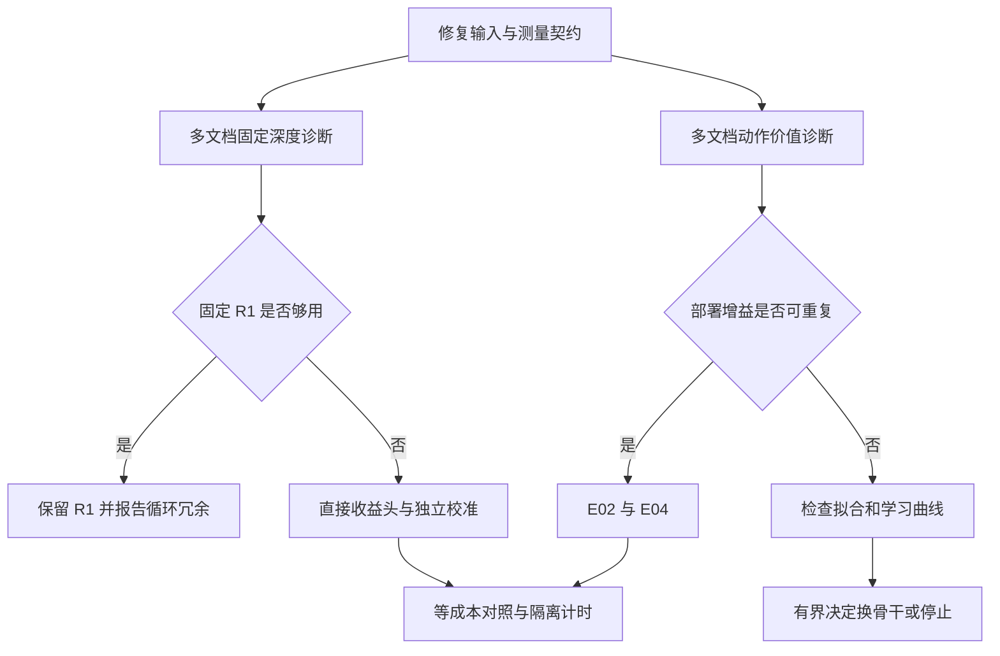

# 修复与复测路线：优先复用现有 M105，逐级开放计算

本文件是审计后建议的实施计划，**其中的训练、重标注和 A6000 性能实验尚未执行**。原始证据、已执行反例和问题编号见 [总报告](00_audit_report_CN.md)。复测结果必须写入新 run 目录，保留旧报告、旧缓存和原提交。

## 1. 目标与决定顺序

接下来最值得回答三个问题：

1. 同一个停止函数是否真的在缓存评测和在线执行中得到相同输入、决策与输出？
2. 固定骨干上，额外循环是否有可重复的质量收益；若有，合法状态能否预测该收益？
3. 预测器的收益能否超过其推理和标注成本，并超过简单固定深度/简单路由规则？



“没有正结果”允许结束某个明确配置；不要求无限扩大样本直到找到阳性。“未充分检验”也不应被写成数学上或机制上不可能。

## 2. R0：先修生产契约和测量，CPU 即可验收大部分内容

| 优先级 | 修复项目 | 修改范围 | 必须满足的验收 |
|---|---|---|---|
| R0.1 | 停止学生用 raw h | `eval/dynamic_halting.py` | 同缓存、非零学生、有限 tau 时，离线/在线 predicted delta、mask、rounds 一致；端点强制测试继续通过 |
| R0.2 | 固定/动态计时边界相同 | `eval/profile_dynamic.py` | 全部只算 input→logits；CE 在计时外；每模式独立 reset peak memory |
| R0.3 | 深度与调用口径 | profile、LM ledger | 监督 token 平均深度与实际全位置 FFN rounds/专家-token对分开；Top-2 乘 2 |
| R0.4 | E12 专家轴与 Module API | `experiments/e12_bidding.py` | 每个专家只读对应摘要；修改一个专家摘要不改变其他专家首层；`.to`/dtype 转换可用 |
| R0.5 | 候选全局/局部及逐状态映射 | `eval/counterfactual.py` | 非前缀子集如 `(0,1),(6,7)` 真正执行所声明动作；baseline 在候选内；记录逐状态 global IDs；共同表与逐状态表分清 |
| R0.6 | checkpoint/恢复 | `train/lm.py`、recovery 训练 | 两段时间相加；历史 best 不被更差值覆盖；恢复 optimizer、RNG、数据位置与必要 hash |
| R0.7 | sampler 每 epoch 复用 | LM 训练 | 与原确定性序列顺序一致；不每 update 洗牌整个数据 |
| R0.8 | 显式评估加载 | `run_recovery.py` | evaluate 对不存在 checkpoint 报错；加载不同已知权重产生相应输出，评估写新目录 |
| R0.9 | 因果性总入口 | `eval/causality.py` | 非法配置拒绝被记录为预期行为；合法检查完整输出，不放松生产约束 |
| R0.10 | 登记状态与成本 | registry/goal report | 实现、执行范围、门禁、科学结论分列；缺失计算为 unknown；CPU GPUh=0 可保留 |

已交付 [最小 patch](patches/minimal_correctness_fixes_with_tests.patch) 只覆盖 R0.1、R0.4 和 3 项对应回归；它没有修复此表其余项。`validate_minimal_patches.py` 在内存加载修改后的模块，不改原仓库。原实现 2 fail+1 error，补丁后 3 pass，证据分别见两个 `minimal_patch_tests_*.json`。

在独立修复分支应用前先确认目标提交，再 `git apply --check`。E12 修复改变旧权重的函数，不应直接拿修复公式与旧权重的组合充当新公平结果。raw-h 修复则是在恢复已有学生的训练输入契约，可先直接复用旧学生量化影响。

不要为了每个纯格式或小重构添加镜像测试；新增检查应针对已定位、会改变实验含义的边界。现有 424 测试已在原提交通过，不应把重复跑测试的次数当作科学证据。

## 3. R1：原检查点上的精确闭环复现

### 输入

优先使用 `runs/e01/m105_100m` 的 students、validation/test states，加一个对应的 M105 model-only 导出和小型原输入包。详见 [下一轮文件清单](03_next_round_artifacts.md)。不需要全部 optimizer 或历史 checkpoint。

### 实验

使用同一 raw h、同一 dtype、同一骨干和学生 hash，逐状态保存：

```text
doc_id, sequence_id, position, baseline_global_action
raw_h_hash, feature_contract_version
offline_delta, online_delta, tau
offline_continue, online_continue, executed_rounds
offline_selected_cost, online_ce, valid_label_mask
```

依次比较：原线上 normalized-h 路径、修复 raw-h 路径、直接缓存离线参考、强制 R1、强制 R4。先 FP32 完成严格契约核对，再检查 BF16 差异。阈值附近样本单列；容忍由相同公式/相同精度的参考误差确定，不能为通过测试任意扩大。

该步骤输出两个不同结论：

- **实现验收**：修复后是否执行同一个策略。
- **对既有结果的影响量**：多少状态改变决策，平均轮数与 NLL 改变多少。

不要从旧小测试集上选择最佳新 tau，再将该成绩当独立确认。这里仅重现与诊断旧结果。

## 4. R2：文档覆盖和数据角色重建

### 4.1 角色分离

保持原方案的 backbone_train、controller_train、controller_validation、backbone_validation、controller_test、lm_test 角色；controller_validation 再拆 model selection 和 calibration。对已有骨干，应从确定未被该骨干更新过的文档池建立新 controller 角色。优先另取新文档。旧三分区中从未正式锁定为 LM validation/test、且未用于选点或分析的文档，可以通过新的 manifest 显式重分角色；这属于划分修订，不应声称原六分区已经原样落实。已锁定的 LM validation/test 不转入 controller_train。所有曾用于选模型、校准或本轮分析的文档整体排除出新确认 test。

先按文档与近重复组分角色，再截取序列/位置。不能仅给同一文档中的 token 随机分组。已有 test 可转为开发诊断集；下一轮封存一份新 test。

### 4.2 状态采样

采样优先覆盖文档，再在每文档随机抽最多 16 个合法 prefix 位置。较短文档用其有效位置，不通过重复同一位置凑数。若该上限导致长文档 token 分布与全语料不同，明确目标是文档覆盖的诊断样本，并同时保留单独自然 token 流的 LM NLL 评测；确认时采用预先声明的抽样/加权估计量。

建议启动规模如下，属于**新设计预算，不是已做实验或统计功效保证**：

| 分区 | 状态目标 | 每文档最多 16 时至少需要的文档数 | 用途 |
|---|---:|---:|---|
| controller_train | 8,000 | 500 | 小头拟合与目标比较 |
| selection | 2,000 | 125 | 学生/超参数选择 |
| calibration | 2,000 | 125 | 只选停止阈值 |
| 新诊断 test | 4,000 | 250 | 一次冻结评测 |
| 合计 | 16,000 | 1,000 | 小规模决策筛查 |

主规模仍可按原 E01 的 100k train / 20k validation / 20k test；其中 20k validation 固定拆为 10k selection+10k calibration。是否扩大由学习曲线、方差、测得的标签成本决定。若 pilot CI 很宽，结果是“不确定”，不能按均值关闭路线。

每个输出必须包含文档数、序列数、最大文档权重、重复位置数、split 交集、近重复组交集、各来源占比。文档级 paired bootstrap 在每次抽样中重算比值 `sum(loss_diff)/sum(valid_tokens)`；不能平均文档 PPL，也不能用 `token_std/sqrt(N)` 冒充文档区间。

### 4.3 降低标注成本的顺序

先修 R0.5，再用共同的 4 候选池：必须含 baseline，其余来自只依赖合法状态的冻结 router 高分候选与预设探索。所有对照使用同一逐状态候选表，记录形状为 N×A 的 global action IDs。现接口仅支持全 batch 共用 A×2 pair 表，需同时扩展逐状态强制执行与评估。学生可保留 28 维输出，仅对已标注候选用 mask 训练，并将部署 argmin 限定在同一 A(s)；另一种含 action ID 的参数化需要另行明示。常量动作或分组规则提出的动作若不在 A(s)，预先固定回退到 baseline 并报告回退率；不能读取未标注成本或为某方法临时扩大候选。单独的 shadow 样本做全 28 候选，检查候选截断丢掉多少 oracle 机会。不能用 test 标签选候选。

默认 E01 对一个状态、A 个动作、总深度 T=4，需要 `4A` 个专家对-token执行及 `2A` 个 head readout，另加共享 prefix 计算与缓存成本。故：

| 标注组 | 状态数 | 候选数 | 专家对-token执行 | head readout |
|---|---:|---:|---:|---:|
| 当前 M105 E01 单次运行的三分区合计 | 10,240 | 28 | 1,146,880 | 573,440 |
| 新覆盖 pilot 设计 | 16,000 | 4 | 256,000 | 128,000 |
| 原主规模 100k/20k/20k | 140,000 | 4 | 2,240,000 | 1,120,000 |
| 同主规模全 28 | 140,000 | 28 | 15,680,000 | 7,840,000 |

这些是算法调用计数，不是 GPUh 估计。跨文档覆盖增加可能提高 prefix 缓存成本；词表 head 也可能占显著时间。须以修复后的账本对代表性分片实测，再决定全量。shadow 全候选只补 4 候选以外的 24 个动作时可复用已有成本，避免重复执行。

## 5. R3：直接检验动作价值是否可学习

### 必需对照

所有方法共享骨干、样本、候选、目标深度与合法输入。当前 r=0、固定 T=4 诊断不需要伪造时间变化；扩展到不同轮次后再显式输入 t 与剩余预算。

| 组别 | 方法 | 要排除的解释 |
|---|---|---|
| 无学习 | 原 router、随机候选 | 标签/部署评测基线 |
| 极低容量 | train-only 常量动作、按 baseline action 分组的规则 | 大 MLP 是否连简单规则都不如 |
| 线性 | raw Q、centered Q、相对 baseline advantage | 是否存在低复杂度可部署信号 |
| 小 MLP | 一个固定隐藏宽度，例如 128，同容量比较上述目标 | 非线性是否必要，避免把容量当机制 |
| 诊断上界 | label-informed oracle | 仅说明动作空间，不计部署收益 |

超参先给两个学习率、一个主 weight decay，必要时一个预先声明的备选，不进行无限网格搜索。所有组的搜索次数和选择数据相同；不能为新方法多看 test。另做训练集拟合与 1k/4k/8k/更大样本学习曲线，定位优化不足、过拟合和数据不足。

### 标签与指标

候选选择的主要监督可用 `Q(s,a)−mean_a Q(s,a)` 或 `Q(s,a)−Q(s,a0)`；部署相同状态内 argmin 不受共同 offset 影响。成本最优候选对应的收益很小或差异不确定时，可保持 baseline，但该回退阈值也只能在 selection/calibration 冻结。

至少报告：部署 NLL 变化、每文档配对变化、baseline 保持率、动作排名、decision regret、common/centered 预测误差分解、训练—验证差距。原绝对 MSE 保留为辅指标，不单独决定科学结论。argmin 标签准确率也不足以体现动作差值大小。

### 开放 E02 的条件

在新文档上，合法学生相对原 router 有重复的收益；收益超过简单规则，并在实际增量成本下仍有意义。先一个骨干做 screening，通过后再训练/选择独立骨干 seeds 确认。三个学生随机种子只反映学生训练不稳定性，不能替代三个骨干种子。

若训练集也拟合不了，应修优化/目标；若训练很好、跨文档差，应检查容量与覆盖；若充分学习曲线与低容量基线都无信号，才有理由在这个骨干/状态接口/预算范围内停止。此时可以保留“oracle 中存在答案知情收益但当前接口没有实用部署收益”的负结果，不强行换更大网络直到阳性。

## 6. R4：停止研究先证明有值得分配的额外计算

### 6.1 固定深度质量图

用同一个冻结骨干在同一批文档上测 R1/R2/R3/R4，保存逐文档 NLL 和逐 token 配对差；用至少固定自然流 1M 有效 token 做 pilot 质量读数，确认规模按原协议开放。另记每轮隐藏状态范数、更新范数、router 熵、专家负载与重复专家率，用于区分平均冗余、个别 token 有用和实现异常。

如果 R1 的独立确认上界已落在应用容忍内，且没有预算区间显示状态条件分配的增量价值，应优先保留固定 R1。不要只选一个较弱 R4 作停止收益的唯一参照。

### 6.2 直接配对收益头

先监督 `Delta_1_to_4 = loss(T1)−loss(T4)`，用线性头和小 MLP；与原两个全成本头相减比较。两者各自单独中心化后相减不合法。扩展为逐轮停止时，必须真实计算相同续算策略下的 T2/T3 及对应状态，不能从端点插值当训练真值。

增加只需当前合法状态的廉价 entropy/margin/hidden-change 机制对照时，要明确其实际实现和 head 开销。若 entropy 是词表 entropy，需要计算词表 head；router entropy 则是另一种信号，不能混名。

selection 选择头，calibration 选 tau，new test 一次评估。非劣阈值可沿用 0.005 nat，但在新 test 前指定单侧置信水平、文档统计和主要预算点。报告实际平均与 p95 深度；validation 目标预算与 test 实现预算分列。

### 6.3 相同成本比较

最低对照：固定 R1/R2/R3/R4、无条件按概率混合深度、廉价阈值策略、direct-delta 头、原双成本头。无条件混合概率由 calibration 的目标平均成本确定，不用标签选择 test 分配；多随机分配种子反映分配噪声。

先给 FFN 调用、控制器 FLOPs、完整推理 FLOPs 三种曲线，再做 wall clock。仅末层多轮节省的 FFN 不代表全模型等比例节省；前 11 层、attention 和词表 head 都仍存在。

## 7. R5：如果需要重训骨干，先修 batch 与匹配，不立即扩大规模

已有 M105 可以继续用于诊断。只有出现下列情形才优先重训：修复后仍显示几乎无循环收益且学习/优化诊断不足，或者要形成架构比较而现有 B0/B1/dense 不匹配。

新的有界训练先固定：有效监督 token 的逻辑 batch、数据流、学习率 schedule、深度抽样、checkpoint metadata 与配平轴。pilot 起点按原协议为约 8192 有效 token/update，主配置约 32768；实现累积时对有效 token loss-sum 归一化，不能直接平均长短不同的 microbatch mean。

动态 GPU 数量变化时，在逻辑 optimizer update 边界切换，保持全局 token 顺序与目标 batch 语义；不足一组的尾部明确处理。单卡 microbatch=1 可由累积形成全局 batch。若用 DDP，明确 loss-sum/有效 token 数的全局归约；不能把每卡局部均值再简单平均。首先验证少量更新与单卡逻辑 batch 对应，不需为整个计划先开发复杂弹性训练框架。

B3/B4/B5 每份新配置写清“匹配哪个模型、哪个深度、哪个成本”：参数匹配、FFN FLOPs 匹配、整网 FLOPs 匹配和 wall clock 匹配是不同问题。用公式与实际 module 参数计数双重核对。训练 token 相同与训练 FLOPs 相同也应分成两个比较轴，不能声称全部同时匹配。

随机深度按明示分布真实抽样，或明确命名为周期深度；如一次逻辑 update 内共享深度，记录这一单位。保存/恢复 sampler、RNG 和 schedule；原 smoke 阶段扩展到正式阶段时显式记录阶段边界，不把跳变 schedule 隐藏为无缝续训。

先 1 seed、100M pilot 再判断，正式 300M 与三骨干 seed 只向关键少数组开放。没有通过机制门槛时，不需要对所有 13 个实验重做大训练。

## 8. R6：支线的最小补救

| 分支 | 有界下一步 | 暂缓条件 |
|---|---|---|
| E07 | 集成 prefix knapsack 完整离线 oracle；修零分母 gap、重排测试；增加真实 T2/T3 标签后再比较策略 | 无真实逐轮收益/服务 trace 时仅称插值离线诊断 |
| E10 | 先修 strict sign-flip 与零带；多文档少量全 28² 标签；检查训练拟合和样本学习曲线 | E01 尚不可信时不扩大到主论文模块 |
| E12 | 修 einsum 后重新训练；central restricted 与 bid 用同 anchor、候选、optimizer；存 adapter 权重和配置 | 无稳定输入价值时只做低成本结构筛查 |
| E05/E06 | 保留势函数与 hard flow 正确性；软放松残差完整输出；真实 predictor→allocator 前缀不变性 | 没有测得负载瓶颈，不主张系统容量收益 |
| E08 | 同一题目/target 下强制 reverse/random/repeat 路径；现有程序族泛化指标改名 | 无需因合成门禁通过就开放 LM 扩规模 |
| 旧 Torch exact | 概率加权精确梯度；只枚举合法唯一终止树；短 budget 概率质量为 1；训练/评估 price 一致 | 未修前禁止用于“精确 RL”对照 |
| 当前 NumPy E09 | 保留已通过的概率/梯度验证；如扩展任务，分开训练目标与 held-out 泛化 | 不把玩具任务结论外推为 LM RL 效果 |

## 9. RTX A6000 的动态分配方案

不假定卡间 NVLink、网络拓扑或稳定独占 8 卡。当前 M105 已有单卡执行记录，首轮修复/状态标注以独立单卡作业为单位，减少卡数变化导致的实现复杂度。

| 可用卡数 | 建议安排 | 约束 |
|---:|---|---|
| 3 | 1 张冻结模型标注；1 张固定深度/特征诊断；1 张按需供学生训练或独占 profile | 小学生也可 CPU；profile 时该 GPU 独占，暂停同卡其他任务 |
| 4–5 | 在上述基础上增加独立文档分片或独立 seed/匹配对照 | 每份标注带 immutable manifest，不能因并行重复计费或混 hash |
| 8 | 仅在门槛通过后并行 3 个骨干 seed 与少量关键对照 | 不因临时拿到更多卡就同时开放所有支线 |

对真实性能测量：同输入长度、batch、dtype、输出边界；CUDA synchronize、warmup、足量重复；每模式重置内存峰值；随机交错模式、记录 GPU 并发与硬件状态。按 E11 原协议做确认时使用其 至少 30 次 warmup、至少 200 步或 30 秒测量、5 次重复等要求。没有独占窗口时可继续质量/标注工作，延迟结论记为待确认。

本轮没有实测新的 A6000 throughput，旧资源账本也有漏记，故不提供伪精确的“几小时一定完成”。正确预算流程是：先测代表性小分片的 prefix、候选 FFN、head、学生训练各阶段耗时，记录实际总时间，再投影下一分片，并与原计划 5%/10% 增量计算门槛核对。超出预算时优先减少候选和无价值分支，保留足够独立文档；不能只保留一个长文档来制造大量状态。

## 10. 每阶段需要交付的结果表

每个 run 至少保存：源码 commit、完整命令/config、原模型与导出文件 hash、数据/tokenizer manifest、split 角色、种子、feature contract、候选映射、实际 token/专家调用/head 次数、分段耗时与重启成本。

| 阶段 | 输出 | 如何决定下一步 |
|---|---|---|
| R0 | 定向回归与修复 diff | 算法身份/测量不一致未消除则不发布新性能结论 |
| R1 | 同状态离线/在线逐 token 对照，旧结果修正差值 | 实现一致后进入新文档采样 |
| R2/R3 | 覆盖统计、学习曲线、决策 regret、文档区间 | 选择继续价值监督、修优化或限域停止 |
| R4 | R1–R4 与停止策略的质量—实际成本曲线 | 固定 R1 够用则优先简化；动态有增量才做系统确认 |
| R5 | 修正 batch/配平的单 seed pilot | 只对关键机制开三骨干确认 |
| R6 | 各分支有界修复与机制结果 | 不以 toy 通过替代 LM/服务证据 |

实施过程中每完成一个关键契约、排除一种失败解释、完成一次关键计算或遇到资源中断，就写短 checkpoint：已知事实、尚未解决的问题、下一项能消除什么不确定性。资源收回时保存逻辑 update 边界和真实已用成本，不以未完成 job 的默认零值更新总账。

原方案来源：[共同协议](https://github.com/kkc25/GB_RL_MoE_Loop/blob/f2bef422f7315f30618f00c690bf82810d1e85ac/plans/loop_moe_research_plan_2026-10-25/protocols/01_common_protocol.md)、[数据规范](https://github.com/kkc25/GB_RL_MoE_Loop/blob/f2bef422f7315f30618f00c690bf82810d1e85ac/plans/loop_moe_research_plan_2026-10-25/protocols/02_data_and_evaluation.md)、[E11](https://github.com/kkc25/GB_RL_MoE_Loop/blob/f2bef422f7315f30618f00c690bf82810d1e85ac/plans/loop_moe_research_plan_2026-10-25/experiments/E11_systems_and_scale_validation.md)。
