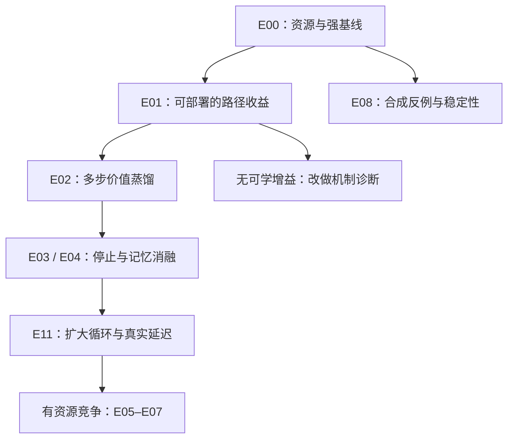

# 研究主线：有限预算下，何时值得规划有序专家路径？

## 1. 建议采用的课题

**中文：循环混合专家中可部署的多步路径价值学习与预算控制。**

**英文工作标题：When Does Multi-Step Expert Routing Pay Off? Budgeted Value Learning in Recurrent MoE.**

这是暂定研究问题，不是已经证实的新算法名称，也不构成“首创”声明。最值得验证的命题是：

> 在参数、可用输入、执行专家调用和总研究计算预算得到控制后，预测“此刻采取一个路由动作、随后继续计算”的任务价值，是否比即时路由分数、一步反事实监督和已有路径记忆 Router 获得更好的样本外性能？收益是否足以支付标签生成与控制开销？

普通Router也通过终局LM损失获得训练信号，Top-k操作本身不证明其必然短视；本计划检验显式反事实续算监督是否提供额外收益。把 Top-k 作为稀疏执行器并不妨碍这一研究。改变分数的训练目标，通常比一开始替换整个执行器更容易归因。对停止、容量、时延则分别建模，直到证据支持组合。

## 2. 对此前讨论的修正

### 2.1 已有工作覆盖的范围比最初设想宽

以下是方法重叠，不是仅名称相似：

| 已覆盖主题 | 最近邻及原始来源 | 对本项目的约束 |
|---|---|---|
| 顺序专家计算与迭代路由 | [Chain-of-Experts](https://arxiv.org/abs/2506.18945) | 串行调用专家本身不新 |
| 循环 MoE 稳定性与逐轮专家多样性 | [LOOM](https://arxiv.org/abs/2610.01153) | 必须有稳定残差、逐轮 Router 的强对照 |
| 监督“继续计算是否有益” | [TaH2](https://arxiv.org/abs/2609.35748) | 监督停止不能单独作为贡献 |
| 冻结模型、反事实路由与 Router-only 偏好更新 | [When Are Experts Misrouted? / EPO](https://arxiv.org/abs/2605.07260) | 必须超过一步、等基数路由偏好对照 |
| 轨迹状态／路径记忆 Router | [MoUE](https://arxiv.org/abs/2603.04971) | 历史信息必须做等容量、等输入的增量检验 |
| 动态偏置与负载均衡 | [Auxiliary-Loss-Free Load Balancing](https://arxiv.org/abs/2408.15664) | 价格更新不能被包装成单独的新方法 |
| 多步搜索后训练轻量预测器 | [PoLar](https://arxiv.org/abs/2606.06574) | 搜索→蒸馏→无在线搜索本身已有先例 |
| 反事实动作与停止，以及一步/完整分支比较 | [LatentHarness](https://arxiv.org/abs/2609.39740) | 必须加入廉价一步soft-policy机制对照，不预设多步更好 |
| 事后oracle膨胀、路径预测器选择失败 | [Dynamic Routing](https://arxiv.org/abs/2610.04751)、[PoLar独立复现](https://arxiv.org/abs/2609.31360) | 负结果也需新的MoE机制与可行动发现 |
| 预算分配 | [Alloc-MoE](https://arxiv.org/abs/2604.08133)、[SeqTopK](https://arxiv.org/abs/2511.06494) | 要明确预算范围、在线因果性和不可撤回调用 |

另有[Foil](https://arxiv.org/abs/2609.35751)与[LatentLoop](https://arxiv.org/abs/2610.19975)研究循环MoE的结构与非对称计算；完整块循环扩展需核对这些设计。表中只概述重叠。逐篇核验状态、全文范围与细节见文献文件。不同工作架构、参数量和数据不同；内部机制对照不冒充完整复现其发表结果。

### 2.2 路径历史不是必然有用

若当前状态对后续转移、允许动作、成本及最终标签/损失条件分布均充分，则历史不会改善 Bayes 最优控制。注意，仅有确定性的隐藏状态转移还不足以证明该充分性：隐藏压缩可能丢失输入信息，而历史保留了它。

因此 E04 区分四件事：增加可用信息、增加函数容量、改善优化、显式记录预算或路径约束。主实验不能只拿“h 的线性头”与“h+history 的大 MLP”比较。

### 2.3 真标签最优路径不等于可部署最优路径

若看到真实下一 token 后从多条路径挑一个，收益可能很大，但真实推理看不到答案。即使输入完全不含标签信息，两个方向相反的预测器也会有很大的逐标签 oracle 优势。

因此不把 `min_a loss(x,y,a)` 回归成未经限定的 Q*。主方案训练每个被评估动作的真实终局成本样本，估计条件期望，再在推理时按预测值选动作。固定基准策略续算的 Q^{π0} 标签是第一选择；“按真标签选最优后续动作”只能作为另列的 oracle 诊断。

### 2.4 势博弈、均衡与语言模型性能是不同结论

固定状态的拥塞博弈可以有精确势函数；异步严格改进可以有限收敛。这既不推出均衡是全局势最优，也不推出社会总效用最优，更不推出隐藏状态变化后的动态系统稳定。价格机制只能优化给定效用；效用如果不反映任务损失，均衡并不能补救。

## 3. 三个相连但可分开的科学问题

### Q1：有多少可以学到的非贪心收益？

E01 用少量精确枚举与较大范围候选搜索量化空间，同时测部署输入上的样本外价值预测。核心比较是相同调用预算下，一步改进与多步续算后的收益排序是否不同；不是仅统计存在某条低损失路径。

**失败也有价值：**若 oracle 看起来巨大而预测器无法泛化，研究可以转为MoE内具体的路由可辨识性与调用序列互补性分析，但“oracle高估或预测器选不出”本身已有先例；必须增加可验证的MoE机制、跨检查点/规模规律或有效修复，不能只重复现象，也不把一次失败推广成不可能定理。

### Q2：多步价值能否廉价部署？

E02 冻结专家，分支替换当前动作，再按固定 π0 续算，学习 Q^{π0}(s,a)。部署仍只执行选定动作。两轮组合成本预测是条件扩展，不在全数据上穷举。

**关键贡献候选：**在等标签成本、等推理调用数下，长期目标相对一步 EPO-style、MoUE-style 历史状态、LOOM-style 逐轮 Router 的增益，以及它出现/消失的条件。

### Q3：收益是否能转化为预算与系统效率？

E03 把 stop 作为动作；E11 扩大到末四块/全块验证总 FLOPs 与真实延迟。只有出现实测拥塞或多请求预算问题后，才引入 E05–E07。单卡所有专家常驻时，均匀负载并不自动提高速度。

## 4. 推荐执行顺序与分支

这是资源分配顺序，不是必须串行等待的日历。CPU 理论、资源校准、文献维护可并行。E09 的 RL 需要单独触发，E10/E12只利用已有反事实标签做小型筛查。

## 5. 模型选择与核心限制

主模型为 12 层、d=512、8 专家、每轮 Top-2、SwiGLU 专家宽度 512、32768 词表、输入输出 embedding 绑定；约 104.92M 总参数。调试模型约 67M；条件确认模型约 180M。详细计算见资源文件。

先只循环最后一层 FFN，其他层 FFN 一次。这样改变一个 token 的最终 FFN 路由后，不会再经后续 attention 改变其他位置；可复用最后 attention 的输出并直接评分。该局部任务不等价于全网络最优路由。

以后扩展到较早层时，改变某位置会经后续 attention 影响后续位置，必须重新执行受影响的因果后缀。固定原始后续 K/V 或只替换局部 logit 是近似，不能混入“精确反事实”结果。

最后一块 R=4 降至 R=1 的总算术节省上限，在统一 105M、S1024 估算下只有约 8%；不是 75%。因此最后层适合机制研究，不能单靠它许诺显著整网加速。

## 6. 预先登记的阶段门槛

下列数字是**本计划的资源决策阈值**，不是文献结论，也不是已观察效果。首次 pilot 后可修改一次并留下记录；确认阶段不得看到测试集再修改。

| 关口 | 继续条件 | 不通过后的动作 |
|---|---|---|
| G0：基础循环可用 | 无 NaN；每种深度单独可评估；共享循环与独立参数对照完成 | 调整残差/归一化；减小循环；暂缓复杂 Router |
| G1：反事实可学 | 持出文档上部署预测器相对强基准改善，非仅 oracle；建议以 ≥0.01 nat/token 为实用信号 | 增加一轮有限数据/容量诊断；再失败转机制分析 |
| G2：长期信息增益 | 多步方法超过等候选、等标签预算的一步方法；3 个骨干 seeds 方向一致，配对区间支持增益 | 保留较便宜的一步方法；不宣称规划贡献 |
| G3：停止可兑现 | NLL 不劣容忍 0.005 nat/token 内，实测总成本下降；最后层只先看机制 | 更换校准/训练深度；无收益则固定深度 |
| G4：系统净收益 | 末四块/全块实测吞吐或 p95 延迟改善；目标 ≥5%，且控制开销计入 | 改作质量论文；禁止用 FLOPs 降幅代替速度结论 |
| G5：扩规模 | 105M 通过且实测预算足够 | 180M 两方法×三 seeds；0.5B+非必要 |

统计不显著不能等同效果为零；应同时报告区间宽度。若只跑得起一个 seed，只能标为探索性结果。

## 7. 算力配置原则

- **3 卡：**优先三个单卡作业（如三个 seeds 或两种基线加一个校准）；不要求三卡专家并行。
- **4 卡：**两个独立作业加一个可测收益的两卡 DDP 作业，或四个单卡作业。
- **5 卡：**2+2+1 用于训练/候选标签/评测；若 DDP 不加速，则继续独立单卡。
- **8 卡：**扩展 seeds 和复核；仅当实测拓扑与通信适合时开 4/8 卡实验。核心结论不依赖抢到 8 卡。

动态 GPU 数量在完整优化器更新边界 checkpoint 后调整。保持逻辑 token 批量和全局样本序列；改变 world size 并不保证位级相同轨迹。所有权重与优化器重启都记录。

## 8. 哪些路线暂不列为完整主线

1. **在大模型上端到端 GRPO 学路由：**对当前核心问题增加了大量混杂；由 E09 的冻结专家小实验替代。
2. **完整动态博弈求均衡再执行每一轮：**控制开销和理论假设尚不成立；由固定状态势博弈/价格/硬调度比较替代。
3. **直接套 Whittle/Gittins 最优性：**token 相互作用、预算约束与暂停/恢复语义未满足；E07 只称收益指数启发式，并与小问题精确 DP 对比。
4. **跨同一自回归序列所有位置做无约束 Sinkhorn/Expert Choice：**未来 token 会改变当前位置路由；E06 限定独立请求的当前前沿或严格因果分块。
5. **精确全专家全路径 Shapley：**指数成本且集合忽略顺序；E10 用匹配成本的有序二阶交互。
6. **只把每个 logit 叫作“报价”：**常常只是普通 Router 重命名；E12先证明/测试等价性。
7. **预设路径必须多样、禁止重复专家：**重复计算可能有益；保留重复专家为合法动作，多样性只做可关闭消融。

## 9. 可能形成的论文，而非预先承诺的结果

**优先稿：**可部署的多步价值改进。须有长期对一步、标签成本对账、条件外泛化、停止/系统边界与失败案例。

**机制稿备选：**什么情况下有序专家组合产生可预测的延迟收益，以及为何在其他设置中消失。oracle与学生差距已有近邻，须在其基础上提供具体MoE机制、匹配成本的可行动改进和多个检查点实证；仅重现失败不足以独立成文。

**优化/系统稿备选：**有负载瓶颈时的价值约束因果分配。须证明硬预算/容量性质，测真实调度收益，并承认价格目标的局部/凸化范围。

最有说服力的结果可以是“较简单的一步方法已经足够”。研究计划不以维护原先设想为目标；每个分支都允许由证据淘汰。

## 10. 最后一次近邻补查后的优先级

[最新重叠审查](literature/04_latest_overlap_and_adjustments.md)把PoLar、LatentHarness、Dynamic Routing、Foil、LatentLoop等纳入。推荐的是一个需要验证的科学问题，而非已证实空白。最小确认比较必须包括：常规Router、一步成本回归、EPO-style偏好、一步soft-policy蒸馏、固定π0续算价值；同候选、同标注成本与同实际调用数。只有多步目标稳定超过这些控制，才把长期价值作为方法贡献。若失败，实施文件中定义的更便宜或诊断分支；不增加模块来掩盖无增益。
